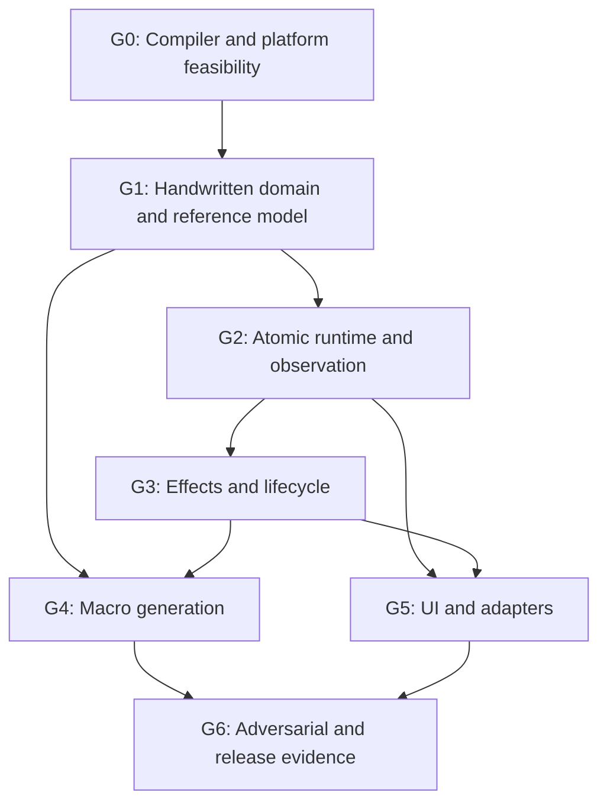

# AtomicState — Complete Implementation Specification

**Version:** 1.0 · **Date:** 2026-11-07  
**Target:** Swift 6.4 / Swift 6 language mode / iOS 16.0  
**Status:** Self-contained specification and acceptance plan; no Swift implementation has been compiled or executed.

Give this complete document to the implementation factory. The factory assignment below is its starting instruction. The chaptered ZIP contains the same substantive documents, a requirement index, and checksums.

## Document map

- [Factory assignment](#factory-assignment)
- [System specification](#system-specification)
- [API and macro contract](#api-and-macro-contract)
- [Runtime contract](#runtime-contract)
- [Acceptance tests](#acceptance-tests)
- [Factory work order](#factory-work-order)
- [Sources and compatibility](#sources-and-compatibility)


---

<a id="factory-assignment"></a>

**Source document:** `FACTORY_PROMPT.md`

## Software Factory Assignment

Implement the AtomicState package specified in this bundle. The entire task context is in these files. No conversation history is required.

### Start here

Read `SPECIFICATION.md`, `API_CONTRACT.md`, `RUNTIME_CONTRACT.md`, `ACCEPTANCE_TESTS.md`, `WORK_ORDER.md`, and `SOURCES.md` before freezing interfaces or dividing implementation work. The combined `AtomicState_Implementation_Specification.md` is an equivalent single-file edition when supplied instead of this bundle.

The intended product is a general Swift state-machine primitive with typed phase transitions, unique owned workflows, typed observations and sealed proposals, atomic runtime admission, and typed asynchronous completion authority. It must run on iOS 16.0 while being compiled with Swift 6.4 in Swift 6 language mode.

### Required outcome

Produce a working repository, not only a design review or generated snippets. Implement the specified runtime, graph macro, hosts, iOS 16 UI adapter, examples, and verification suite. Preserve the guarantee boundary between compile-time structure/ownership, runtime temporal checks, and trusted domain logic.

Use the work order's phase dependencies. Begin with G0 compiler and deployment probes. Do not spend the first phase building macros before proving that the generated code shape, privacy boundary, ownership signatures, and iOS 16 backend work in an external client module.

### Implementation rules

- Use OSAllocatedUnfairLock as the baseline Apple shared-storage backend.
- Keep the initial shared commit payload Copyable and Sendable. Consume noncopyable public proposals before capturing the internal payload in the SDK lock closure.
- Do not substitute an unrestricted reducer/store API for the sealed typed domain facade.
- Do not expose bare hosted success/failure methods that bypass operation completion capabilities.
- Do not hold locks across suspension or execute application callbacks, validators, custom hashing, or final user-payload destruction under them.
- Do not turn cancellation into fictitious task termination. Retain task handles until termination is observed.
- Do not silently discard completed outcomes under queue pressure or conflicts.
- Do not silently replay user preparation. Implement the declared retryPure default for generated managed owners, the explicit manual policy, and the manual default of raw runtime hosts.
- Do not use experimental language flags or raise the deployment baseline to make a probe pass.
- Treat source samples as interface targets until compiler-validated. Correct spelling or implementation mechanisms where needed while retaining the normative semantics.
- Treat publicly accessible raw runtime APIs as a lower-level mechanism. The generated facade's private kernel, provenance, and constructors must remain inaccessible to external clients.

### Division of work

Appoint one integration owner for the shared API and requirements ledger. Parallel agents may own language/deployment probes, core admission, effect lifecycle, macro generation, UI integration, and independent verification. Keep ownership of files explicit. Agree on generated names and test fixtures before integrating independently authored components.

Every implementation change should name the requirements and tests it satisfies. Record an actual blocker with a minimal reproducer and equivalent alternatives. Do not hide a semantic deviation inside a generic refactor or replace a missing proof with unchecked conformance.

### Completion evidence

Deliver:

1. Exact commit, toolchain, SDK, build flags, and deployment targets.
2. Commands and results for compiler-negative fixtures, including external-client sealing checks.
3. Results for the reference model, adversarial runtime schedules, lifecycle/shutdown, and macro tests.
4. Actual iOS 16 execution evidence for the baseline adapter, or an explicit release-blocking absence of that evidence.
5. Reproducible performance observations with no invented parity claims.
6. A requirement-to-test traceability report, remaining limitations, and the final client API documentation.

Finish only when the work order's release gates pass, or when a concrete environment/compiler blocker prevents completion and is reported with completed work and a precise next action. Do not label unexecuted tests, an uncompiled macro expansion, or successful execution only on a newer OS as completion of the corresponding gate.


---

<a id="system-specification"></a>

**Source document:** `SPECIFICATION.md`

## Atomic State Machine Implementation Specification

**Working package name:** AtomicState  
**Specification version:** 1.0  
**Date:** 2026-11-07  
**Audience:** A software factory of implementation, verification, review, and documentation agents  
**Compiler baseline:** Swift 6.4, Swift 6 language mode  
**Primary deployment baseline:** iOS 16.0  
**Status:** Normative implementation requirements. This document is not evidence that a Swift implementation already exists or that the illustrative declarations have compiled.

### 1. Assignment and authority

Implement a reusable Swift package for modeling state and legal state transitions across Apple-platform applications. The package must maximize compile-time structural and ownership guarantees while presenting ordinary value data to UI, modeling, persistence, testing, and effect code. It must support both exclusively owned workflows and long-lived state whose current value changes at runtime.

The user wants the practical meaning of “if it compiles, it is correct” pushed as far as Swift 6.4 allows. Implement this as an explicit division of responsibility:

- The type system checks state shapes, transition source and destination types, payload types, ownership, and supported isolation crossings.
- A small runtime checks temporal applicability: owner identity, current revision, active operation authority, cancellation, and atomic publication.
- Trusted domain definitions supply correct validation and effect-free transition logic. Swift does not prove arbitrary business rules, deep value semantics, purity, liveness, or exactly-once external execution.

No prior conversation is required. This specification, the factory work order, and the acceptance suite contain the requirements. Do not infer additional product requirements from the package name, examples, or language-feature names.

#### 1.1 Normative language

**MUST / MUST NOT** are acceptance requirements. **SHOULD / SHOULD NOT** allow a documented deviation supported by a concrete technical reason and equivalent guarantees. **MAY** denotes an optional addition. Requirement identifiers are stable within this specification version.

The specification is authoritative for semantics. `ACCEPTANCE_TESTS.md` defines the corresponding verification obligations. `WORK_ORDER.md` defines sequencing and ownership of factory work. If a test example conflicts with a normative requirement, correct the example and record the correction; do not weaken the requirement silently.

Illustrative Swift is an API design target. Gate G0 must establish exact syntax and availability with the pinned compiler and SDK. A spelling change that preserves the contract is an implementation decision. Removing a guarantee, increasing the minimum deployment target, requiring experimental compiler flags, or changing a documented semantic outcome is a specification deviation and must be reported explicitly.

#### 1.2 Required delivery

The factory must deliver an implementation repository containing:

1. The package and generated-domain macro tooling.
2. A hand-written reference domain that exercises the same runtime without macro expansion.
3. Compiler-positive and compiler-negative client fixtures.
4. Runtime, lifecycle, concurrency, macro, and deployment tests.
5. iOS 16 UI examples and a networking/effect example.
6. Documentation of guarantees, trusted boundaries, operational limits, and deployment availability.
7. Reproducible validation commands and evidence tied to the exact commit and toolchain.

Implementation completion requires passing the release gates in the work order. Generated source, plausible snippets, test counts without results, and tests run only on a newer OS are not substitutes for that evidence.

### 2. Product goals and scope

#### 2.1 Required goals

| ID | Requirement |
| --- | --- |
| GOAL-001 | Model legal states using concrete structs and closed enums, with required data present in each state. |
| GOAL-002 | Provide a consuming typestate API for exclusively owned workflows. |
| GOAL-003 | Provide typed, copyable observations and noncopyable prepared transitions for dynamically changing state. |
| GOAL-004 | Make shared commits linearizable: preconditions, state replacement, authority changes, revision assignment, and effect recording form one indivisible operation. |
| GOAL-005 | Keep transition computation synchronous and separate from execution of external effects. |
| GOAL-006 | Prevent obsolete, cancelled, foreign, and duplicate async completions from changing authoritative state. |
| GOAL-007 | Generate static and dynamic interfaces from one graph definition, so their legal edges cannot drift. |
| GOAL-008 | Make iOS 16.0 a first-class supported target using OSAllocatedUnfairLock for Apple shared storage. |
| GOAL-009 | Keep task scheduling, observation, and synchronization out of ordinary domain transition code. |
| GOAL-010 | Preserve distinct behavior for local, actor-isolated, and synchronously shared ownership instead of pretending they are interchangeable. |

#### 2.2 Included in the initial implementation

- Value model types and validated input boundaries.
- Owned typestate workflows, including an explicitly owned-only path for unique resources.
- Local and MainActor dynamic owners.
- A synchronously callable shared owner using the iOS 16 lock backend.
- An actor-hosted adapter where callers already use actor isolation.
- Typed effects, operation authority, cancellation, ordered delivery, and explicit lifecycle management.
- Generated domain facades and compile-time schema diagnostics.
- Snapshot observation and an iOS 16-compatible UI adapter.
- Root-level composition, explicit invalidation scopes, validated restoration, and explicit forking.
- Structured diagnostics suitable for tracing and testing without executing hooks while locks are held.

#### 2.3 Explicit non-goals

- A universal UI framework, dependency-injection framework, networking client, database, or application architecture.
- Distributed transactions or automatic atomic commits across separately owned roots.
- Durable exactly-once external effects.
- Arbitrary rollback of reference mutations, files, network actions, or consumed unique resources.
- Lock-free or wait-free progress guarantees.
- A general theorem prover, refinement-type system, purity checker, or proof that user-authored business logic is correct.
- Mandatory experimental lifetime annotations or underscored compiler features.
- A requirement to use every new Swift feature merely because it exists.

### 3. Platform and language contract

#### 3.1 Supported configuration

| Dimension | Required baseline |
| --- | --- |
| Compiler | Pinned Swift 6.4 release toolchain; record exact patch/build |
| Language mode | Swift 6 |
| iOS / iPadOS / Mac Catalyst | 16.0 |
| macOS | 13.0 |
| tvOS | 16.0 |
| watchOS | 9.0 |
| visionOS | 1.0 |
| Apple shared synchronization | OSAllocatedUnfairLock |
| UI observation baseline | Combine/ObservableObject-compatible adapter on iOS 16 |
| Newer Observation adapter | Optional separately availability-gated adapter |
| Experimental compiler flags | Prohibited in required products and client fixtures |

`COMPAT-001`: Compile the public core with a nonisolated default. Test consumption from both ordinary Swift targets and app targets configured for MainActor default isolation. Do not allow app-default isolation to accidentally isolate generic runtime functions or static schema requirements.

`COMPAT-002`: Compiler availability and OS runtime/library availability are separate. Every newly used standard-library or SDK facility needs an availability entry and a minimum-target compile probe. Core semantics must not depend on optional modern storage types that cannot run on the supported baseline.

`COMPAT-003`: The required implementation uses ordinary copyable sendable commit storage and the safe OSAllocatedUnfairLock API. Synchronization.Mutex may be an additional backend after parity testing; it is not a dependency of the baseline. Do not use a runtime OS check as a substitute for compiling stored-property layouts and generic signatures correctly at the minimum deployment target.

`COMPAT-004`: Basic ownership, consuming enum matching, typed transition APIs, macros, and checked concurrency remain part of the baseline. Ref, MutableRef, UniqueBox, UniqueArray, and related facilities are optional internal optimizations pending exact deployment verification. Use ordinary functions, arrays, and encapsulated storage when they provide equivalent semantics.

`COMPAT-005`: Custom @_lifetime / @lifetime interfaces, Disconnected, unverified Optional ownership conveniences, and proposed yielding-accessor spellings must not become required public dependencies. Source reports conflict on the placement of some features; resolve exact support through G0 rather than assuming a proposal's acceptance means it shipped. See SOURCES.md.

#### 3.2 Suggested package layout

| Target | Responsibility |
| --- | --- |
| AtomicState | Ownership/value support, raw runtime kernel, hosts, authority, effects, observation, diagnostics, and the public macro declarations; a graph needs only this import |
| AtomicStateMacroPlugin | Host-side SwiftSyntax/SwiftCompilerPlugin implementation |
| AtomicStateUI | Apple UI integration, including the iOS 16 adapter |
| AtomicStateTestSupport | Optional explicit testing helpers; never grants raw access to a production facade |
| AtomicStateTests | Runtime and hand-written reference-domain tests |
| AtomicStateMacroTests | Expansion and diagnostic tests |
| ClientFixtures | Separate-module compiler-positive and compiler-negative programs |
| Examples | Profile loader, document workflow, and an owned resource protocol; built for tests and probes, never published as a product |

The compiler plugin's SwiftSyntax version must match the selected Swift 6.4 toolchain. Pin an actual verified release; do not invent a version number from the compiler version. Runtime products must not import SwiftSyntax or ship the plugin's dependency graph into an application process.

Public import/re-export behavior must be tested. Generated source must use names available to the client through documented imports; underscored re-export attributes are not a required solution.

### 4. Vocabulary and semantic model

| Term | Definition |
| --- | --- |
| Definition / schema | One closed graph of named phases, typed edges, operations, and invalidation scopes |
| Phase | A concrete payload type representing one valid state shape |
| Model / root state | The complete copyable domain value replaced by one dynamic commit |
| Owned state | A noncopyable value carrying exclusive authority to evolve one phase |
| Owner | The object or value that determines the current committed state of one history |
| Snapshot | An immutable observation of a root, including private provenance and public read-only phase data |
| Observed phase | A phase-specific view of one snapshot, exposing only legal outgoing preparation methods |
| Prepared transition | A noncopyable, inert, domain-sealed candidate based on one observation |
| Commit payload | The runtime's private copyable data extracted by consuming a prepared transition |
| Revision | A monotonically increasing, nonwrapping commit number over an owner's lifetime; reset changes incarnation but does not reset this number |
| Incarnation | A new authority epoch created by restoration/reset; identity is distinct from payload equality |
| Activation | One particular lifetime of an invalidation scope |
| Operation ticket | A copyable, typed, private-construction token authorizing a particular async operation to submit a result |
| Completion | A typed outcome plus its ticket; creation does not itself modify the owner |
| Effect intent | Inert immutable data describing external work to start/cancel; never executable user code under a lock |
| Commit batch | The ordered notification and effect records recorded with an accepted commit |
| Runner | The runtime component that drains batches and manages effect task handles outside core locks |
| Receipt | A historical observation proving a commit was accepted; it does not prove it is still current |
| Close | An irreversible end of admission for one owner; current data may remain readable |
| Shutdown | Close plus an explicit policy for task cancellation and runner termination |

`CORE-001`: “Atomic” means that an accepted operation validates against one committed version and publishes one whole successor with its authority changes and effect records. It does not mean a hardware atomic instruction, a lock-free algorithm, or one transaction spanning network work.

`CORE-002`: Every commit path is synchronous. An actor caller may await entry to a host, but the actual check/install operation must not suspend. Async effects reenter through subsequent transitions.

`CORE-003`: The root is the smallest domain whose invariant requires joint replacement. Separately owned roots do not compose into an implicit atomic transaction.

`CORE-004`: A shared handle intentionally has identity/reference semantics. Do not label a struct containing a shared owner reference as an independently copyable machine value.

`CORE-005`: Model equality is never proof of freshness. Returning to an equal state does not revive an old snapshot, scope activation, operation ticket, or receipt.

### 5. Required invariants and trust boundaries

#### 5.1 Invariants

| ID | Invariant |
| --- | --- |
| INV-001 | Every publicly observable committed root has one of the schema's valid state shapes. |
| INV-002 | Every accepted domain transition was constructed through a declared edge of that domain. |
| INV-003 | One noncopyable owned predecessor cannot be implicitly duplicated or used after consumption. |
| INV-004 | A snapshot or prepared transition cannot mutate a different owner or incarnation. |
| INV-005 | Whole-root replacement requires the complete expected root revision to match. |
| INV-006 | An async completion changes state only if all its required authority remains active at the commit point. |
| INV-007 | Terminal completion retirement and its model change are one commit; duplicates admit at most once. |
| INV-008 | State, authority updates, commit numbering, and recorded effects are either all committed or all unchanged. |
| INV-009 | A rejected preparation/commit starts no work, cancels no work, and publishes no new committed snapshot. |
| INV-010 | No application-controlled callback, transition body, validator, equality/hash implementation, or final payload destruction executes while the core lock is held. |
| INV-011 | Subscribers observe monotonically ordered committed observations; coalescing never reverses order. |
| INV-012 | Fork/restoration cannot adopt the completion authority of the source history accidentally. |
| INV-013 | Effects execute only after their corresponding commit; their future completion cannot extend the commit's atomic interval. |

#### 5.2 What the compiler establishes

The compiler can check the existence of required fields, available methods for a static phase, source/destination types, completion payload types, noncopyable use, and supported isolation crossings. Generated exhaustive switches can force schema dispatch completeness. Constructors and stored properties must be access-controlled so external clients cannot manufacture domain authority.

#### 5.3 What the runtime establishes

The runtime establishes ordering, current owner/revision matching, activation membership, cancellation/supersession, duplicate retirement, queue admission, subscription initialization, and lifecycle transitions. These are temporal facts that cannot be established by a stale static type alone.

#### 5.4 What remains trusted

`TRUST-001`: Domain definitions and their generated implementation are trusted to express the intended graph and business validation. A user who edits the implementation that mints authority can change the domain's rules.

`TRUST-002`: Every copyable hosted model, including an isolated model, must have semantic value behavior: a copied observation cannot mutate authoritative state through an alias. Shared root data additionally must be Sendable. Sendable does not prove deep immutability or independent copies. Actors, synchronized classes, unsafe wrappers, and aliased references can be sendable without satisfying this model contract. Actor confinement alone does not turn a mutable reference payload into an immutable historical observation.

`TRUST-003`: Transition preparation and validation must be synchronous and effect-free. Borrowing, consuming, nonisolated, Sendable, and typed throws are not purity annotations. Reads of time/randomness and external results must be materialized as explicit input values.

`TRUST-004`: Public clients must not need unchecked concurrency conformances. The baseline typed lock adapter must use the SDK's safe API. Any optional generalized compatibility primitive containing unchecked/unsafe code must be private, separately documented, tested, and excluded from the baseline proof unless actually selected.

`TRUST-005`: Runtime/kernel APIs used by generated code may be public for module access, but no raw kernel instance, raw admission stamp, raw candidate initializer, mutable pointer, or unchecked replacement method may be exposed through a sealed domain facade. A public generic kernel is a lower-level tool with a weaker domain contract; it must not be presented as the same proof surface as a generated domain.

`TRUST-006`: Construction guarantees apply to the supported statically typed public API. They are not a security sandbox against reflective extraction of private implementation storage, unsafe casts, debugger mutation, memory corruption, or edits to trusted domain/generated source. Source access control must prevent ordinary supported API calls from manufacturing authority. A custom diagnostic mirror exposing only public model information is permitted, but must not be presented as a complete security boundary.

#### 5.5 Claims the product must not make

The product must not claim that compilation proves eventual completion, that affine ownership requires a value to be used, that actor isolation makes an entire async function atomic, that task cancellation prevents every late result, that a macro proves arbitrary user code pure, or that in-memory effect recording provides durable exactly-once network execution.

### 6. State representation and validation

`TYPE-001`: A phase's payload must contain the facts needed in that phase. Prefer enum cases with associated payloads over independently mutable booleans and optionals representing one mutually exclusive lifecycle.

`TYPE-002`: Derived data should be derived or be updated inside the same root transition. The library must not maintain untyped duplicate phase flags beside a typed phase payload.

`TYPE-003`: Validation boundaries may use typed throws or closed rejection sums. A successfully constructed validated input becomes a reusable typed fact. Its semantic validation remains a domain responsibility.

`TYPE-004`: Decoder paths must use the same semantic validation as normal construction. Synthesized decoding must not bypass a smart constructor's invariant.

`TYPE-005`: Restorable model data is distinct from ephemeral authority. Live tickets, observed-phase provenance, prepared transitions, and kernel identity stamps must not receive Codable conformances.

`TYPE-006`: A read projection must not leak a mutable alias to authoritative root storage. For custom payloads, document the required value semantics and enforce every part that Swift can check.

#### 6.1 Reference domain

The reference shared domain loads a profile. The following root shapes are mandatory in the hand-written and generated conformance fixtures:

```swift
enum ProfileState: Sendable {
    case idle(Idle)
    case loading(Loading)
    case loaded(Loaded)
    case failed(Failed)
}

struct Idle: Sendable { let userID: UserID }
struct Loading: Sendable { let request: ProfileRequest }
struct Loaded: Sendable { let profile: Profile }
struct Failed: Sendable {
    let request: ProfileRequest
    let failure: ProfileFailure
}
```

| Edge | Source | Input | Destination | Effect/authority action |
| --- | --- | --- | --- | --- |
| load | Idle | Validated ProfileRequest | Loading | Register/start FetchProfile |
| loaded | Loading | Successful FetchProfile output | Loaded | Retire operation |
| failed | Loading | Failed FetchProfile output | Failed | Retire operation |
| cancel | Loading | Explicit user cancellation | Idle | Revoke/cancel operation |
| refresh | Loaded | Validated ProfileRequest | Loading | Register/start FetchProfile |
| retry | Failed | Explicit retry input | Loading | Register/start FetchProfile |

A root-composition test adds unrelated presentation state and an authentication scope. An unrelated presentation edit must survive profile completion. Authentication invalidation must revoke the fetch even if the profile phase remains visually loading.

### 7. Architecture decisions that all implementations must preserve

#### 7.1 A typed observation is historical evidence

`OBSERVED-001`: An observed phase means that a particular owner held that phase at a particular revision. It does not mean that the owner still holds it. The observed value may be copied, retained, inspected, and used to construct competing proposals. Only commit supplies current applicability.

`OBSERVED-002`: A commit receipt is also historical. Another caller may commit immediately after it. APIs and documentation must not label a receipt as a lasting lease on the destination phase.

`OBSERVED-003`: The owner reads the root and provenance in one synchronized observation. Reading the phase and revision independently is forbidden because they could describe different commits.

#### 7.2 A sealed proposal is sufficient without phantom source/destination parameters

The required hosted API uses a domain-specific noncopyable `Prepared` type. Legal source/destination relationships are enforced at its private construction sites and through methods on typed observations. Extra public generic source/destination parameters are optional and must justify their usability and compile-time cost.

A closed prepared type lets one dispatch path return different legal branches without existential erasure, unsafe casts, or a universal constructor. The exclusively owned API still carries the phase in its type.

`PREPARED-001`: No public construction path may accept an arbitrary root and valid provenance to make a domain Prepared value. A helper intended for a macro is not protected merely by an underscore or an SPI label.

`PREPARED-002`: Preparation has no external effect. Preparing and then abandoning a value must be safe. It must not reserve execution capacity, create a task, invoke a callback, or cancel a task.

`PREPARED-003`: A shared Prepared value is consumed before entering the OSAllocatedUnfairLock closure. The internal payload captured by that closure is immutable, Copyable, and Sendable. This preserves the noncopyable public API without relying on consuming a captured noncopyable value inside the SDK's older closure interface.

#### 7.3 Completion authority is not replaceable by a bare result

`COMPLETION-001`: Generated hosted success/failure edges must require a sealed operation completion capability. A public `Observed<Loading>.succeeded(Profile)` overload would bypass operation provenance and is forbidden for operation-bound edges.

The corresponding owned workflow may accept a bare result because its caller controls that sequential workflow. Its documentation must not claim hosted stale-result protection for an arbitrary value supplied by that caller.

`COMPLETION-002`: Only committed work may mint a usable completion. A Prepared transition must not expose new Work or ticket authority before admission.

`COMPLETION-003`: Ticket validity and root revision are separate. Unrelated root edits need not revoke an operation. A completion must nevertheless be prepared from a current root and pass the whole-root revision check when replacing that root.

#### 7.4 Default behavior must expose contention honestly

`CONFLICT-001`: A general shared synchronous owner exposes conflicts. It must not silently rerun a caller's preparation function, replace newer state, or report a blocked completion as successfully applied.

`CONFLICT-002`: A MainActor or actor host may provide the ordinary conflict-free prepare/commit path only while it is the sole mutation authority and the pair does not suspend. Do not leak another unrestricted synchronous committer to that same core and retain the conflict-free claim.

`CONFLICT-003`: Automatic replay of domain transition computation is opt-in. A `retryPure` policy explicitly requires replay-safe, synchronous, effect-free domain computation over immutable explicit inputs. The compiler does not prove that semantic contract. Clock, randomness, network, decoding, and external dependency calls must not be implicitly repeated by the retry loop.

`CONFLICT-004`: Backpressure may postpone completion delivery. The runtime must retain the completed outcome, report its pending disposition, and keep it within execution-capacity accounting. It must not silently drop a result while leaving a permanent loading state. Manual reconciliation is an explicit supported policy, detailed in RUNTIME_CONTRACT.md.

#### 7.5 Unique resource support is a separate ownership path

`RESOURCE-001`: Shared speculative root replacement uses Copyable model data. A unique resource must not be moved into a candidate while pretending it still exists in the current model.

`RESOURCE-002`: The owned-only graph mode may contain noncopyable phases and resource-bearing payloads. Consuming transitions must return the original owner on rejection or validate before a nonthrowing ownership transfer.

`RESOURCE-003`: A hosted model may refer to an explicitly managed external resource by a value identifier. This does not make the resource copyable or part of transactional rollback. The resource's lifecycle and cleanup must remain explicit in the runner/owner contract.

### 8. Composition and model boundaries

#### 8.1 Atomic aggregates

`COMPOSE-001`: If session, document selection, and synchronization authority must change together, they must be part of one committed root or an explicitly implemented higher-level coordination protocol. Two independently locked machines do not provide a joint invariant.

```swift
enum WorkspaceState: Sendable {
    case signedOut
    case signedIn(AuthenticatedWorkspace)
}

struct AuthenticatedWorkspace: Sendable {
    let session: Session
    let document: DocumentState
    let synchronization: SynchronizationState
}
```

Hierarchical data is preferred to flattening every combination of independent phases. A shared parent may contain child state values. It must not contain separately mutable child owners and claim their independent changes are atomic with its own root.

#### 8.2 Child projection

`COMPOSE-002`: A child observation projected from an aggregate retains the parent observation's provenance. A child transition that installs a whole parent still compares the parent revision. A read-only key path or child phase check is not a replacement for root freshness.

`COMPOSE-003`: In the initial implementation, compose by explicitly constructing the next aggregate value outside the lock. A projection/optics convenience may generate that reconstruction, but it must not allow arbitrary writable key paths into live storage or invent merge semantics.

`COMPOSE-004`: Automatic rebasing requires a proven/generated reconstruction over the current parent and all relevant dependency checks, or the explicit retryPure contract. Do not reuse an old whole-root candidate merely because its child operation remains active.

#### 8.3 Dynamic children

`COMPOSE-005`: A removed and reinserted child receives a new activation identity even when its user-visible ID is equal. A result for the prior child must never update its replacement.

`COMPOSE-006`: User-defined key hashing/equality, dynamic lookup, and validation execute outside the core lock. A runtime registry inside the lock uses generated ordinals or retained engine-owned identities. If mapping changes between lookup and commit, revision and child-activation checks reject the candidate.

First-class dynamic child orchestration is optional convenience in v1, but the underlying aggregate/ticket mechanism and its remove/reinsert acceptance scenario are mandatory. The library must not claim automatic support for cross-root transactions as a substitute.

### 9. UI and application integration

`UI-001`: The baseline adapter supports iOS 16 with a MainActor-isolated observable object and a copyable snapshot projection. The runtime does not require SwiftUI; UIKit consumers can use the same snapshot subscription API. The UI module provides a generic presentation over any MainActor owner that conforms to the runtime's small host protocol (`snapshot`, `send`, `commit`, `subscribe`, `close`); generated MainActor owners conform. It publishes the accepted snapshot of an input in the same turn as `send`, publishes the owner's current snapshot in the same turn as `commit`, returning the owner's `CommitResult` unchanged, and applies later deliveries through the owner's subscription. Creating the presentation never throws, so it can initialize a view's `@State`: if the owner refuses the registration, `isObserving` is `false` and a read-only `observationFailure` holds the reason, while the presentation still publishes the owner's snapshot at creation and every change made through it. A presentation can also observe a shared or actor owner through its snapshot sequence.

`UI-002`: The UI owner retains the live machine privately. UI state contains copyable observations/model projections, not a raw lock, a mutable root pointer, or a noncopyable live authority embedded in a copying view value.

`UI-003`: Publish complete snapshots. Consumers must never observe independently published fields from two different revisions as one purported atomic state.

`UI-004`: Snapshot application occurs on MainActor and checks the commit ordinal. A delayed delivery must not regress the visible model. UI delivery may coalesce to the latest snapshot, but it must not coalesce effect commands. Ordinals are counted per owner, so a passive presentation that changes the owner it shows takes that owner's current snapshot as its new baseline: it shows the snapshot at once, restarts the ordinal check from it, and discards every later delivery and finish from the observation it replaced. Observing without a new baseline continues the same owner's history. A replacement claims its observation before it shows the new baseline, and stores its registration only if that claim still stands, so a synchronous callback that switches sources again during the publication or the registration wins, and the replaced registration is cancelled rather than installed over it.

`UI-005`: A newer Observation-based adapter may be provided with proper OS availability. Internal authority and lock storage must be excluded from automatic observation tracking. Observation callbacks must not execute while the commit lock is held. The package provides this adapter as an `@Observable` counterpart of the baseline presentation, with the owner excluded from tracking. The Observation adapters take the short names, `StateMachinePresentation` and `SnapshotPresentation`, and the iOS 16 `ObservableObject` adapters are `StateMachineObservableObject` and `SnapshotObservableObject`; each pair has the same members.

`UI-006`: The UI sample must demonstrate initial load, retry, cancellation, rapid request replacement, navigation away, and return. It must not access real services for conformance testing. A controlled fake driver supplies delayed and reordered outcomes.

#### 9.1 Dynamic input ingress

Buttons, decoded messages, timers, and other external sources may arrive without a statically known current phase. Their generated input dispatcher performs an explicit runtime match and returns a documented routing rejection if the input has no legal edge.

Do not claim the dynamic input enum makes every input legal in every phase. Phase-specific observation methods remain available for clients that can establish a specific source case locally.

A dynamic input acts on whatever the owner holds when it is routed. An edge method on an observation acts on exactly that observation: its proposal commits only while the observation is the owner's current whole-root revision, and a revision that landed in between, related or not, is reported as a conflict. The typed form is compile-checked, so removing an edge or moving it to another phase is a compile error at every typed call site, whereas a dynamic input fails at run time with an invalid-phase rejection. Clients use dynamic input for events that apply to the current state and the typed form for an action that belongs to the observation the user saw.

#### 9.2 Networking and computation

Network work receives immutable operation inputs and returns a typed result. The effect driver must not receive an unrestricted reference to the entire machine as its ordinary interface. Result provenance comes from its Work capability.

Blocking computation and synchronous work before the first suspension must not accidentally run on the coordinator/MainActor merely because a task inherited that isolation. Pin the intended execution policy in the driver/runner implementation and test it. Task detachment, if used, must not imply unowned lifetime: the coordinator still retains and observes every task handle.

### 10. Diagnostics and performance contracts

`DIAG-001`: Diagnostics carry domain, owner-safe correlation ID, incarnation, commit ordinal, edge/operation tags, disposition, and relevant capacity counts. Do not require exposing private authority objects or serializable live tickets.

`DIAG-002`: User hooks, log formatting, custom descriptions, and tracing exports run outside the core lock. Construct minimal engine-only diagnostic records under the lock and format them afterward.

`DIAG-003`: Do not retain an unbounded operation tombstone history merely to distinguish cancelled, already-completed, and otherwise inactive operations. Report inactive authority unless a bounded retained record actually establishes a more specific reason.

`PERF-001`: The baseline creates stable lock storage per owner. It must not allocate a new lock per commit. Whole-root data may use ordinary value-semantic copy-on-write storage; do not require a deep copy on every read.

`PERF-002`: Do not claim identical performance to Synchronization.Mutex or lock-free progress. Measure the actual iOS 16 backend and representative model sizes. State synchronization, preparation, observation, and effect dispatch costs separately.

`PERF-003`: Identity safety takes priority over eliminating every allocation. Retained identity markers and immutable payload boxes may be optimized only after tests preserve ABA resistance, lifetime boundaries, and deferred destruction.

`PERF-004`: Compilation and diagnostics are product qualities. Avoid encoding the entire graph as a deeply nested type expression when generated nominal types yield clearer diagnostics. Record macro expansion size and client compile times for small, medium, and large graphs.

`PERF-005`: No numeric performance target is assumed without a measured baseline. A release gate may reject an accidental regression against that recorded baseline; it must not invent an unsupported nanosecond budget.

### 11. Required reading order for implementation

1. This document establishes purpose, scope, and invariants.
2. `API_CONTRACT.md` defines the schema and generated client surface.
3. `RUNTIME_CONTRACT.md` defines admission, queues, effects, observation, and lifecycle algorithms.
4. `ACCEPTANCE_TESTS.md` supplies executable verification obligations.
5. `WORK_ORDER.md` assigns implementation phases, dependencies, and release gates.
6. `SOURCES.md` records language/SDK evidence, uncertainty boundaries, and source provenance.

The combined single-file edition contains these same documents in that order. The implementation factory may choose the combined edition or the chaptered bundle; both are generated from the same content.


---

<a id="api-and-macro-contract"></a>

**Source document:** `API_CONTRACT.md`

## AtomicState API and Macro Contract

**Version:** 1.0  
**Baseline:** Swift 6.4, Swift 6 language mode; iOS 16.0 deployment  
**Audience:** Implementation, macro, verification, and integration agents  
**Status:** Normative design requirements. Declaration sketches are proposed API shapes, not claims of successful compilation. The compiler/SDK spike must establish exact supported spellings without experimental flags. A spelling correction may preserve this contract; weakening ownership, authority, isolation, or deployment guarantees requires an explicit specification deviation.

This document defines the domain-facing surface and the schema-to-runtime boundary. `SPECIFICATION.md` defines the complete transaction, runner, lifecycle, and deployment semantics. Requirement identifiers here start at 101 to avoid collisions with that document. **MUST**, **MUST NOT**, **SHOULD**, and **MAY** have their usual normative meanings.

### 1. Supported graph modes

`TYPE-101`: A schema MUST choose one mode explicitly. Mode selects generated APIs and conformances; it is not a runtime switch.

| Mode | Phase data | Generated ownership surfaces | Effect execution |
| --- | --- | --- | --- |
| `.shared` | `Copyable & Sendable`, with semantic value behavior | Owned, local, MainActor, actor adapter, shared | Managed reference hosts; manual Local |
| `.isolated` | `Copyable`; no blanket Sendable requirement | Owned, local, MainActor | MainActor/isolated adapter; manual Local |
| `.ownedOnly` | May be `~Copyable` | Owned | Explicit caller-controlled execution and ownership handoff |

`TYPE-102`: Mode `.shared` MUST require checked Sendable conformance for inputs, effects, phase payloads, and operation outcomes crossing isolation boundaries. Mode `.isolated` MUST NOT acquire Sendable through unchecked conformance. A concrete isolated snapshot cannot receive a conditional conformance pretending that its fixed payload types are generic.

`TYPE-103`: All hosted copyable model data, including isolated-mode data, MUST satisfy the value-semantics contract: a copied snapshot must not provide a mutable alias into authoritative state. Neither isolation nor Sendable establishes this. Transition purity, business validation, and correct invalidation dependencies remain trusted domain responsibilities. Owned-only resources follow their separate explicit ownership contract.

`TYPE-104`: An owned-only resource graph MUST NOT automatically receive copyable snapshots, optimistic preparation, or shared storage. An application may place identifiers or immutable projections of resources in a separate value graph, with an explicit resource owner. The library MUST NOT silently copy resources or imply general rollback of their consumption. Baseline effects remain Copyable inert descriptions in every mode because `[Intent]` stores Copyable elements; unique resources travel through consuming phase payloads. A unique-intent container would require a separately verified extension.

### 2. Schema grammar

`MACRO-101`: `@StateMachine` attaches to one enum declaration. Its only argument is literal `mode` metadata. Exactly one phase case declaration carries the `@Initial` marker. Invalidation scopes are the payload-free cases of an optional nested `Scope` enum; omitting it declares no scopes. The root attribute cannot reference the schema's own members, because resolving them requires the expansion that attribute introduces; initial-phase and scope metadata therefore live in the body. Phase cases, the scope enum, input/effect enums, operation declarations, transition declarations, and routers MUST appear in that lexical declaration. Cross-file scanning, extension discovery, runtime reflection, and string-based runtime dispatch are prohibited.

`MACRO-102`: Each phase case MUST contain exactly one unlabeled payload whose type is a distinct nominal struct or enum declared directly inside the schema. Phase aliases and reuse of one payload type for multiple cases are prohibited in this grammar. This restriction makes `Observed<Idle>` and `Owned<Idle>` identify one phase unambiguously. Payload fields may use imported types, generic containers, and validated domain types normally. The `@Initial` case, and only that case, MAY declare a default value for its payload, as in `@Initial case idle(Idle = Idle())`. The default MUST be a call with no arguments that constructs the payload (`Idle()`, `.init()`, or `Idle.init()`) or calls a static function declared directly inside the schema, written qualified or unqualified (`makeIdle()`, `AtomicState.makeIdle()`, or `Self.makeIdle()`). Any other expression is rejected at the expression with a diagnostic that asks for a static function returning the payload. A default on any other phase case, or on an `Input` or `Scope` case, is rejected. When a default is declared, every fresh entry point declares it on its initial parameter, spelled fully qualified as `<Schema>.<Payload>()` or `<Schema>.<function>()`: `Local.init`, `Shared.init`, `ActorHost.init`, `MainActorHost.init`, and the schema's `owned(_:)` factory, including in `.ownedOnly`. Each construction that omits the payload evaluates the call once. A `restoring:` initializer has no default, because saved data is always explicit. The compiler, not the macro, checks the call's access level, isolation, `throws`, and failability.

Generic schema parameters and constraints MAY be preserved if the compiler spike verifies the complete generated surface. If unsupported in the first release, that limitation MUST be documented; do not emit partially working generic schemas. Metadata for generic definitions MUST NOT depend on unsupported generic static stored properties.

`MACRO-103`: Nested `Input` is a closed enum whose cases have zero or one unlabeled payload; an empty enum represents no inputs. `Effect` is generated, never authored: it has exactly one case per `@Operation` namespace, carrying that namespace's `Input`, named by lower-casing the leading capital run of the namespace name (`Fetch` to `fetch`, `URLLoad` to `urlLoad`). A namespace whose case name would be a keyword, a duplicate, or a generated member name is rejected. For each edge with a nonempty `starts` list the macro also generates a nested `Effect.<Edge>` enum, named by capitalizing the edge function's name, containing exactly the cases of the started operations and a lowering to `Effect`.

Schema metadata names declarations by reference. The accepted spellings are `Input.<case>` for an input trigger, `Scope.<case>` for a scope, and `<Type>.self` for a phase payload or an operation namespace. The compiler resolves each reference, so an undeclared name is a type-checking error at the attribute. Expansion reads the same spelling lexically, rejects a reference of the wrong kind, and lowers it to generated primitive tags. An edge's endpoints are not metadata: its source phase is the payload type of its source parameter (a router names it the same way), and its destination phase is its result when that is a phase payload, or the payload type named by its `Change` or `Advance` result. These signature types MAY be qualified with `Self.` or the schema name. A trigger is exactly one of `on: Input.<case>`, `onSuccess: <Operation>.self`, or `onFailure: <Operation>.self`. Input, scope, phase, and operation references must use the spellings listed above. String literals, implicit members such as `.load`, extra qualifiers such as `ProfileFlow.Input.load`, computed references, and arbitrary expressions cannot name those declarations. Edge names cannot be overloaded. A marker attribute, including the schema macro itself, MAY be written with its module qualifier, as in `@StateMachine.Transition` and `@StateMachine.StateMachine(mode:)`, and a `Change` or `Advance` result MAY be written `StateMachine.Change<…>`. The schema name `StateMachine` and a direct member of that name are reserved, because generated code qualifies the runtime's short type names with the module name. An `Input` case payload MAY name a type declared inside `Input`. An operation whose `Failure` is spelled `Swift.Never` is infallible, the same as `Never`.

The following excerpt shows the required shape for a subset of the reference domain plus an authentication invalidation edge. Omitted bodies and payload fields are intentional specification placeholders.

```swift
@StateMachine(mode: .shared)
nonisolated public enum ProfileFlow: Sendable {
    public struct Idle: Sendable { /* initial data */ }
    public struct Loading: Sendable { /* request data */ }
    public struct Loaded: Sendable { /* profile data */ }
    public struct Failed: Sendable { /* request and failure */ }

    @Initial case idle(Idle)
    case loading(Loading)
    case loaded(Loaded)
    case failed(Failed)

    enum Scope { case load, authentication }

    public enum Input: Sendable {
        case load(ProfileRequest)
        case cancel
        case authenticationChanged(AuthenticationChange)
    }


    @Operation(scope: Scope.load, requires: [Scope.authentication], activeIn: [Loading.self], admission: .latest)
    public enum Fetch {
        public typealias Input = ProfileRequest
        public typealias Output = Profile
        public typealias Failure = NetworkFailure
    }

    @Transition(on: Input.load, invalidates: [Scope.load], starts: [Fetch.self])
    fileprivate nonisolated static func begin(
        _ source: Idle, _ input: ProfileRequest
    ) throws(LoadRejection) -> Change<Loading, Effect.Begin> { /* ... */ }

    @Transition(on: Input.cancel, invalidates: [Scope.load])
    fileprivate nonisolated static func cancel(
        _ source: Loading
    ) -> Idle { /* ... */ }

    @Transition(onSuccess: Fetch.self)
    fileprivate nonisolated static func received(
        _ source: Loading, _ output: Fetch.Output
    ) -> Loaded { /* ... */ }

    @Transition(onFailure: Fetch.self)
    fileprivate nonisolated static func failed(
        _ source: Loading, _ error: Fetch.Failure
    ) -> Failed { /* ... */ }

    @Transition(on: Input.authenticationChanged, invalidates: [Scope.authentication])
    fileprivate nonisolated static func authenticationChanged(
        _ source: Loading, _ change: AuthenticationChange
    ) -> Loading { /* update session-bearing root data */ }
}
```

`MACRO-104`: `@Initial`, `@Transition`, `@Operation`, `@Route`, and `@Restoration` are metadata markers; the root macro generates supporting members beside the original declarations. In particular, generate `FetchWork` and `FetchCompletion` as members of `ProfileFlow`. Do not depend on rewriting the existing nested `Fetch` enum. Generated names MUST be deterministic, reserved, and diagnosed on collision.

`MACRO-105`: In value modes, a transition is a synchronous static function with a source parameter that is unannotated or explicitly `borrowing`, and an optional trigger payload. An edge with no `starts` list returns its destination phase payload directly. An edge with a `starts` list returns `Change<Destination, Effect.<Edge>>`, so an effect for an operation outside that list cannot be written. The wrong result shape for the declared `starts` is rejected at expansion with the required shape named. It MAY use typed throws. The support type has the following shape, with checked conditional Sendable conformance where its stored values permit:

```swift
@frozen nonisolated public struct Change<Next: ~Copyable, Effect>: ~Copyable {
    public let next: Next
    public let effects: [Effect]

    public init(_ next: consuming Next, effects: [Effect] = []) {
        self.next = next
        self.effects = effects
    }
}

extension Change: Copyable where Next: Copyable {}
extension Change: Sendable where Next: Sendable, Effect: Sendable {}
```

Change contains no executable callbacks. Async functions, untyped throws, inout source mutation, variadic parameters, and method-level generic edge signatures are unsupported in this grammar.

Each edge has exactly one destination. Branching is expressed by explicit routers selecting several declared edges. Attribute `starts` is the set of operations whose effects the edge may emit, not a promise to emit them; it determines the cases of the edge's generated effect type. Omission means the edge returns a bare destination and can emit no effect. `invalidates` lists declared scopes to revoke if the edge commits.

### 3. Generated values and ownership

`API-101`: Generate domain-specific `Owned`, `Observed`, `Snapshot`, `Prepared`, `PreparationRejection`, `CommitResult`, and `Receipt` declarations. Generated generic phase wrappers accept only privately constructed instances; arbitrary client specializations grant no authority.

The shared-mode shape is:

```swift
public struct Owned<Phase: ~Copyable>: ~Copyable {
    fileprivate var phase: Phase
}

public struct Observed<Phase: Sendable>: Sendable {
    fileprivate let payload: Phase
    fileprivate let provenance: /* concrete runtime observation type */
    fileprivate let planLimits: /* immutable concrete limit values */
    public var value: Phase { payload }
}

public enum Snapshot: Sendable {
    case idle(Observed<Idle>)
    case loading(Observed<Loading>)
    case loaded(Observed<Loaded>)
    case failed(Observed<Failed>)
}

public struct Prepared: ~Copyable, Sendable {
    fileprivate let envelope: /* concrete runtime candidate type, or its plan defect */
}

public enum CommitResult: Sendable {
    case committed(Receipt)
    case rejected(CommitRejection, current: Snapshot)
}
```

Concrete runtime specializations MUST replace the comments. They MUST NOT become `Any`, forced casts, unchecked casts between phase payloads, or a universal untyped envelope.

`API-102`: `Prepared` is intentionally nongeneric. A sealed constructor plus phase-specific preparation methods already establishes which declared edge produced it; commit has no use for phantom source/destination parameters. This simplification also permits an explicit router to return different legal destinations without broad type erasure. Prepared MUST be noncopyable and inert. Dropping it has no committed effect.

`API-103`: Snapshots and observed phases are copyable historical values. They retain hidden owner, incarnation, and complete root-revision provenance. Public phase/value/revision diagnostics MUST NOT be accepted as substitutes for that provenance. Plain model enums remain constructible data; constructing one does not authorize installation into a live host.

`API-104`: Generate only applicable phase-constrained input preparation methods, for example:

```swift
public func begin(_ input: ProfileRequest)
    throws(LoadRejection) -> Prepared where Phase == Idle

public func cancel() -> Prepared where Phase == Loading
```

Generate these as constrained members or equivalent concrete phase-specific declarations verified by the compiler spike. Do not emit illegal nested extensions. An observation of Idle MUST NOT expose Loading's edge methods. An observation exposes exactly the input edges whose source is its phase, including an edge that returns to that phase. A routed input exposes its router's method instead of its candidate edges (`ROUTE-105`). An observation exposes no completion edge: a terminal outcome reaches its edge only through delivery (`DELIVERY-003`).

`API-117`: An observed edge method throws exactly what its authored function throws, with the same typed failure, and an infallible authored edge gives a nonthrowing method: `host.commit(searching.cancel())`. Generated wrappers validate actual effect descriptors and state-independent limits while preparing; PlanRejection includes invalidPlan and planTooLarge. A plan defect is not a preparation failure. It travels inside the sealed Prepared together with the snapshot it was prepared on, and admission reports it after the foreignOwner and closed checks of `COMMIT-004` and before any later one: `commit` returns `.rejected(.plan(reason), current:)`, `send` throws `.commit(.plan(reason))`, and nothing is installed. A defective proposal from another owner reports foreignOwner, and one submitted to a closed owner reports closed, including a plan whose defect only closure caused because closing removed the scopes its work needs. Preparation still runs outside the shared lock. An observation privately carries immutable host limit values, without retaining or reaching back into the live host. Dynamic routing preserves typed domain cases in its closed rejection enum.

`API-105`: The initial factory accepts only the declared initial phase, optionally defaulted as `MACRO-102` defines. Owned factories consume unique initial payloads. No universal public initializer may wrap an arbitrary phase, model, raw observation, or raw candidate as domain authority. Restoration and fork MUST use explicitly named, validated facilities with fresh history identity as defined in the main specification; they MUST NOT adopt live tickets or synthesize a generic state-replacement setter. In a macro-declared graph the facility is the `restoring:` initializer defined by `MACRO-109`.

The generated `Owned` exposes the nonescaping borrowed accessor `borrowing func withValue<Result: ~Copyable, Failure: Error>(_ body: (borrowing Phase) throws(Failure) -> Result) throws(Failure) -> Result`, which can return a noncopyable value and rethrows the closure's typed failure; a call with a nonthrowing closure needs no `try`. Owned values MUST NOT return a unique payload by ordinary copying. The generated `Owned` has `consuming func takeValue() -> Phase` in every mode, which ends the owned authority and moves its payload out, so a finished unique payload can be handed to another consuming API; `takeValue` is reserved, like `withValue`, as an edge or router name. Conditional Sendable conformance is permitted only when checked by the compiler from actual stored data.

### 4. Construction authority and the runtime bridge

`API-106`: Macro expansion occurs in the consuming module. Raw runtime types and constructors MAY therefore be public for generated code to call. The generated facade MUST privately own its raw kernel and MUST NOT expose that kernel, its admission stamp, mutable storage, or a public raw-candidate factory through its supported statically typed APIs.

`API-107`: Authority-bearing initializers and backing properties MUST be `private` or `fileprivate`. Using `fileprivate` consistently is permitted for generated sibling declarations. The domain definition file is trusted implementation code. Neither a naming convention nor public SPI is an access-control boundary. Guarantees exclude reflective extraction of hidden implementation storage, unsafe casts, debugger manipulation, and memory corruption; this is not a security sandbox. Custom diagnostic mirrors exposing only public projections MAY improve encapsulation but are not the baseline proof.

An ordinary client may instantiate a separate raw kernel. That kernel cannot produce authority accepted by an existing sealed facade: the existing facade's kernel/provenance is inaccessible, and admission checks owner identity. Public raw kernels MUST be documented as a separate, lower-guarantee surface.

`API-108`: A consumed Prepared MUST be unpacked into a concrete immutable, copyable commit payload before entering the shared kernel's safe `OSAllocatedUnfairLock` closure. This does not make Prepared copyable or expose an external candidate factory. The checked lock storage uses Copyable and Sendable values; no public client is required to add `@unchecked Sendable`.

All user transition code, routing, validation, payload examination, and metadata construction run outside that lock. Under-lock work operates on trusted primitive metadata and retained immutable storage. The implementation MUST also defer final release of user-controlled payloads until after unlock.

### 5. Operation capabilities

`TYPE-105`: Each `@Operation` namespace declares explicit nongeneric `Input` and `Output` aliases, and a `Failure` alias unless the operation cannot fail. Without a `Failure` alias the operation's failure is `Never`, and generated code never names `<Operation>.Failure`, so an authored signature that names it does not resolve. Failure conforms to Error; `.shared` requires every declared type to satisfy its checked isolation requirements. Each operation has exactly one generated effect case (`MACRO-103`). The namespace is metadata, not an executor. A schema without operations generates none of the work, completion, or delivery surface (`API-118`).

`API-109`: For operation Fetch, generate the following sealed values:

```swift
public struct FetchWork: Sendable {
    public let input: Fetch.Input
    public var execution: ExecutionHandle { get }
    fileprivate let authority: /* concrete operation authority */
    public func succeeded(_ output: Fetch.Output) -> FetchCompletion
    public func failed(_ failure: Fetch.Failure) -> FetchCompletion
}

public struct FetchCompletion: Sendable {
    public let result: Result<Fetch.Output, Fetch.Failure>
    fileprivate let authority: /* concrete operation authority */
}
```

These have no public authority-bearing initializers. The work of an operation that cannot fail has no `failed(_:)`, because it has no failure to seal, and its completion exposes `public let value: Output` in place of `result`; the operation's `PendingCompletion.Outcome` case carries that `Output` rather than a `Result`. A fallible operation keeps `Result`. Also generate a closed domain `Completion` enum with one case per operation. Wrapping an already valid completion is harmless; constructing its hidden authority is prohibited.

`API-110`: A sealed completion is admitted only by its owner's `deliver`, which `Local` alone offers; no owner accepts a bare Output or Failure. Delivery prepares the matching completion edge against a current snapshot, combining its provenance with the completion's operation authority, and commit checks both. Authority includes the owner/incarnation, its primary scope activation, every declared dependency activation, and operation instance identity. For convenience, `deliver` also accepts one operation's sealed completion directly, and an operation whose Output is `Void` offers a `succeeded()` that takes no value; neither admits an unsealed outcome. An `Owned` phase keeps its completion edge methods, which take the bare Output or Failure: `Owned` holds no work authority and retains no outcome. When a completion router chooses among a phase's completion edges, `Owned` exposes one method named for the router in place of those edges' methods, which are fileprivate, exactly as for an input router (`ROUTE-105`), so an owned caller obeys the router that delivery runs.

Work and completion are intentionally Copyable and Sendable in shared mode. This supports asynchronous callbacks without attempting to consume one captured noncopyable token repeatedly. Duplicate copies can request delivery, but successful terminal admission retires the operation atomically. This is at-most-once admission, not proof of honest driver results or exactly-once external execution.

`API-111`: An operation has one terminal outcome. Progress events and streams are not implicit repeated uses of its completion token. Model a stream through separately specified events/operations with explicit lifecycle and authority, or use a dedicated extension outside this version's terminal-operation contract.

### 6. Effects, admission policies, and execution

`ROUTE-101`: Operation admission is exactly one of `.latest`, `.rejectWhenActive`, or `.parallel(limit: N)`, where N is a positive bounded integer literal. An `@Operation` that omits `admission:` uses `.latest`. A policy group is `(primary scope activation identity, generated operation-kind tag)`. Locked lookup uses generated primitive tags and bounded slots; private retained markers distinguish instances, and diagnostic ordinals never wrap. No application-defined Hashable or Equatable implementation may execute under the core lock.

| Policy | Required admission behavior |
| --- | --- |
| `.latest` | Permit at most one new intent per group per commit; revoke that group's older active members before enrolling the replacement. |
| `.rejectWhenActive` | Permit at most one new intent per group per commit; reject if an active member remains after prospective invalidation/retirement. |
| `.parallel(limit: N)` | Give each admitted intent distinct authority; reject if the group's resulting active-authority count would exceed N. |

The parallel limit bounds logical active authority, not physical concurrent tasks. A cancelled worker can stop counting in its policy group while still executing. Separately, global execution reservations count queued/running work, cancelled work that has not finished, and retained terminal results awaiting reconciliation. Revocation alone never frees a reservation. Release requires terminal disposition of both execution and retained delivery obligations; admission uses the prospective post-commit accounting defined by the runtime contract.

`ROUTE-102`: The kinds an edge may emit are fixed by its generated effect type, so emitting an operation outside `starts` is a type-checking error rather than a plan defect. How many times a body emits each kind is not statically known. Generated preparation lowers the actual emitted array to concrete descriptors and primitive kind/count metadata outside the lock, rejecting permanent plan defects such as excess multiplicity. Commit rechecks trusted plan metadata and validates eligibility, multiplicity, policy, and available capacity/queue bounds. Failure publishes nothing and starts/cancels no work. Declaring `starts: [Fetch.self]` does not prove a body emits fetch exactly once.

`ROUTE-103`: Leaving a scope's eligible phase set revokes its activation. Explicit `invalidates` revokes scopes even when the visible phase stays unchanged. Prospectively apply invalidations and terminal retirement before checking new admissions; publish the complete result only after every check succeeds. An emitted operation and all its required scopes must be eligible in the destination phase. Domain authors MUST declare semantic dependencies; the macro cannot infer them from arbitrary field mutations.

`ROUTE-108`: `@Operation` has one primary scope and an optional `requires` list of additional declared scopes, defaulting to empty. The primary scope is the declared `Scope` case named by `scope:`, or, when `scope:` is omitted, a private scope of that operation alone, eligible exactly in its `activeIn` phases, which no authored reference can name and so no edge can invalidate. A schema whose operations all omit `scope:` and whose edges invalidate nothing needs no `Scope` enum. Work binds the post-commit activation of every scope in that union. Operations sharing a named primary scope MUST declare identical `activeIn` sets; that set defines the scope's phase eligibility. A scope used only as a dependency spans all root phases. On entry, create a fresh activation; on exit, retire it. Explicit invalidation rotates to a fresh identity if the scope remains eligible, otherwise leaves it inactive. An activation records an epoch, not proof of business authorization.

Invalidating any bound dependency revokes the operation and records cancellation even if its primary scope remains active. The example therefore supports authentication invalidation while Loading: Fetch requires authentication, and the authenticationChanged self-edge invalidates that scope. The old fetch cannot commit; subsequent work binds the new epoch. Validate all dependency names and reject duplicate/redundant dependencies or inconsistent primary-scope eligibility.

`API-112`: Generate a typed shared-mode Drivers value, with one field per operation. A driver for an operation whose failure is `Never` returns its `Output` directly. A driver for an operation that can fail returns `Result` rather than using typed throws: in the pinned toolchain a closure passed to a `throws(Failure)` parameter is inferred as throwing `any Error` unless it is explicitly annotated, which would require an annotation on every throwing driver closure. Each operation has exactly one driver form.

```swift
public struct Drivers: Sendable {
    public let fetch:
        @Sendable (Fetch.Input) async -> Result<Fetch.Output, Fetch.Failure>
    public let audit: @Sendable (Audit.Input) async -> Audit.Output  // Audit cannot fail
    public init(
        fetch: @escaping @Sendable (Fetch.Input) async
            -> Result<Fetch.Output, Fetch.Failure>,
        audit: @escaping @Sendable (Audit.Input) async -> Audit.Output
    )
}
```

The runner receives committed Work, invokes the matching driver outside core locks, creates a sealed terminal completion, and requests delivery. Generate actor-isolated equivalents for isolated mode; do not send non-Sendable inputs through a nonisolated worker automatically. Synchronous or callback adapters MUST preserve the same completion authority and lifecycle bookkeeping.

Cancellation invalidates admission before late results can commit. Physical cancellation remains cooperative. A driver cannot be assumed to stop immediately, and a discarded or obsolete result still requires task/registration cleanup.

### 7. Dynamic dispatch, branching, and conflicts

`ROUTE-104`: Generate `prepare(_:on:) throws(PreparationRejection) -> Prepared` for dynamic Input routing. A missing input/source edge throws an explicit invalid-phase rejection. It MUST NOT silently ignore the input. Direct methods throw their authored failure; dynamic dispatch preserves domain failures in a generated closed PreparationRejection enum with a case for each throwing edge and router and one for the structural routing failure. A plan defect travels in the returned Prepared (`API-117`).

`ROUTE-105`: Exactly one edge for a `(source, trigger)` pair permits generated dispatch. Multiple edges for one source and trigger require one router marked `@Route(on:)`, `@Route(onSuccess:)`, or `@Route(onFailure:)`. The router takes the source phase payload. It also takes the input's associated value when present, or the operation's output or failure for a completion trigger. With candidate edges, it returns `Route.<Router>`, with one case per edge sharing that source and trigger. Generated dispatch then calls the selected edge with the sealed outcome, so a router can neither prepare a transition itself nor select another trigger's edge. A router MAY use typed throws to decline; the failure becomes a `PreparationRejection` case named for the router. A router with no edge to choose returns `Never` and must throw. For example:

```swift
@Route(onSuccess: Fetch.self)
fileprivate nonisolated static func routeFetched(
    _ source: Loading,
    _ profile: Fetch.Output
) throws(Unusable) -> Route.RouteFetched {
    // Inspect the plain value and select a declared completion edge,
    // or throw to leave the retained outcome for reconciliation.
}
```

Routes are synchronous, effect-free trusted domain functions. They cannot authorize a transition: they return only a choice among declared edges. Every path to a routed edge runs its router, so a rule the router enforces binds every caller. For an input router with candidate edges, the observation and the `Owned` value expose one method named for the router in place of the candidate edges' methods, which are fileprivate. For a completion router with candidate edges, the `Owned` value exposes that method, and the observation has none because its completion edges are reached only through delivery:

```swift
// Observed: runs the router, then prepares the selected edge.
public func choose(_ input: Bool) throws(Problem) -> Prepared where Phase == Loaded

// Owned: runs the router, then advances through the selected edge.
public consuming func choose(_ input: Bool) -> Route.ChooseResult where Phase == Loaded

public enum ChooseResult: ~Copyable {   // nested in Route
    case restart(Owned<Idle>)
    case keep(Owned<Loaded>)
    case rejected(Problem, Owned<Loaded>)   // the router declined; the source is returned
}
```

The observed method throws the failure type that every throwing function of the group shares, however many of them throw, and `PreparationRejection`, with a case named for each throwing function, only when their failure types differ, so adding a candidate that throws the same type leaves the signature unchanged. `send` and `prepare(_:on:)` always report a `PreparationRejection` case named for the function that threw. The owned method returns the candidates' common result directly when the router cannot throw and every candidate returns the same type; otherwise it returns `Route.<Router>Result`, with one case per candidate holding that edge's own result and, when the router throws, a `rejected` case holding the failure and the source. A throwing router therefore cannot choose an edge named `rejected`. A router with no candidate edge gives no method; `send` and `prepare(_:on:)` report its rejection. A completion router runs during delivery and through its `Owned` method. In `.shared` mode `Route.<Router>Result` is `Sendable`, like the owned values its cases carry. Every operation outcome/source combination in `activeIn` MUST have an unambiguous route, except the failure of an operation that cannot fail: one that declares `Failure = Never` (`Never` or `Swift.Never`) or declares no `Failure` alias. Routers may explicitly reject an otherwise well-typed outcome.

`ROUTE-106`: Terminal delivery prepares against a current snapshot and commits with full root-revision validation plus operation authority. MainActor/actor owners normally perform preparation and commit in one isolated turn without an intervening await. Shared owners may encounter intervening commits.

A generated managed owner takes one `completionPolicy:` argument of its own `CompletionPolicy` type, spelled `.retryPure`, `.retryPure(onReconciliationRequired:)`, or `.manual(onReconciliationRequired:)`, defaulting to the bare `.retryPure` (`ROUTE-107`). A handler takes the generated `PendingCompletion` in the owner's isolation: `@Sendable` for `Shared` and `ActorHost`, `@MainActor` for `MainActorHost`. Whenever a retained completion's status becomes `reconciliationRequired`, the owner passes it to the policy's handler outside the lock: because a completion edge or router rejected it, its plan is defective, or admission refused it (`DELIVERY-008`), because an explicit reconciliation did not commit, or, under the manual policy, because its preparation lost a root conflict (`DELIVERY-005`). A pure conflict retry under either `.retryPure` form is not reported. The bare `.retryPure` has no handler, so a retained completion is then reported only by `pendingCompletions()`. Raw runtime hosts keep a separate policy value and callback, and default to manual. Expose `pendingCompletions()` and `reconcile(id:)`; pending IDs are opaque typed runtime identifiers. Reconciliation performs one new preparation attempt against a current snapshot. A pending record includes the operation, typed outcome, and reason needed to diagnose or resolve it; it is not an untyped error bag. Claim an attempt atomically before invoking user preparation; concurrent reconciliation of that entry returns `inProgress`, not a duplicate callback invocation.

`ROUTE-107`: `.retryPure` is a host contract permitting reevaluation of declared pure routing/preparation. A macro-declared graph's completion edges and routers are synchronous static functions over the source payload and the captured outcome, and the schema author is responsible for keeping them deterministic and free of side effects, which the compiler does not prove; on that basis `.retryPure` is the default of generated managed owners, and `.manual(onReconciliationRequired:)` is the explicit choice for a graph whose completion preparation must not run twice. It MUST NOT be selected implicitly for arbitrary custom code, so raw runtime hosts default to manual. Limit a delivery turn to four preparation attempts, then yield through the runner's scheduling mechanism. Revalidate authority and lifetime at every attempt; never reuse a stale whole-root candidate or busy-spin inside the lock. Obsolete, retired, or closed-owner outcomes are disposed according to lifecycle rules, with reservation cleanup.

Managed capacity-only retry retains the private copyable candidate and retries admission after capacity becomes available, without invoking preparation again. A newly detected root conflict returns to the selected conflict policy; permanent invalid/oversized plans require reconciliation rather than endless capacity retry. This internal facility does not make a consumed public Prepared reusable.

### 8. Hosts and public lifecycle

`API-113`: Generate a final shared owner with synchronous core entry points:

```swift
public final class Shared: Sendable {
    private let core: /* concrete kernel specialization */
    public init(
        _ initial: Idle, drivers: Drivers,
        configuration: Configuration = .default
    )
    public func snapshot() -> Snapshot
    public func commit(_ prepared: consuming Prepared) -> CommitResult
    public func pendingCompletions() -> [PendingCompletion]
    public func reconcile(id: PendingCompletionID) -> ReconcileResult
    public func discardPending(id: PendingCompletionID) -> DiscardResult
    @discardableResult public func close() -> Receipt
    public func flush(through receipt: Receipt) async -> FlushResult
    @discardableResult
    public func shutdown(deadline: ContinuousClock.Instant? = nil) async -> ShutdownResult
    public var runningCount: Int { get async }
    public var subscriberCount: Int { get }
}

public enum ShutdownResult: Equatable, Sendable {
    case quiescent
    case timedOut(ShutdownDiagnostics)
}

public enum FlushResult: Equatable, Sendable {
    case processed
    case foreignOwner
}
```

When its schema declares operations, every managed host MUST receive its appropriately isolated Drivers value during initialization and retain that selection immutably for the owner's lifetime, and each initializer takes one `completionPolicy` argument of the owner's `CompletionPolicy` type that defaults to `.retryPure` (`ROUTE-106`). No ambient mutable driver installation is permitted. `Configuration` sets the capacity bounds. `Shared`, `MainActorHost`, and `ActorHost` offer one shutdown verb, `shutdown(deadline:)`, whose result is discardable. The deadline defaults to `nil`, so `shutdown()` waits without a deadline. The method closes the owner and returns `ShutdownResult.quiescent` once the obligations in `LIFE-004` settle. If the deadline expires first, it returns `ShutdownResult.timedOut` with `ShutdownDiagnostics`. `ShutdownDiagnostics` is an `Equatable`, `Sendable` struct that holds no model data or authority and names its retained completions by the schema's `PendingCompletionID`. `close()` returns a discardable receipt on every owner. `flush(through:)` returns `FlushResult.processed`, or `.foreignOwner` for a receipt another owner issued (`LIFE-003`). Each managed owner of a schema that declares operations reports `runningCount`, the workers whose joined termination is still unprocessed, and every managed owner reports `subscriberCount`, its live registrations; both are `async` on `ActorHost`, and `runningCount` is `async` on `Shared`, whose workers belong to an actor-isolated coordinator. `ShutdownResult`, `ShutdownDiagnostics`, and `FlushResult` are reserved generated names, generated wherever a managed owner is. A managed owner offers no `deliver`: it issues work only to its own drivers, so no caller holds a completion it could deliver, and `pendingCompletions()` exposes each retained outcome only as an inert value. Each pending operation has its own closed result with only the cases it can produce. `deliver` on `Local` returns `DeliveryResult` (committed receipt, retained pending identifier and status, stale, or foreign owner). `reconcile(id:)` and `retryAdmission(id:)` return `ReconcileResult` (committed, pending, `inProgress`, or `notPending`). `discardPending(id:)` returns `DiscardResult` (discarded receipt, admission rejection, or `notPending`). None of them conceals a conflict as success. `PendingCompletionID` is a nominal `Hashable` and `Sendable` struct generated per schema with private storage, so an identity from another graph does not type-check; two owners of one graph are still distinguished at run time. Synchronous queries use the runtime's protected pending-record snapshots; actual task handles remain coordinator-owned. A schema with at least one operation also generates, on each managed owner, a convenience initializer that takes each operation's driver closure as its own parameter, in declaration order, in place of `drivers:`. Each label is the operation's effect case followed by `Driver` (`fetchDriver:` for `Fetch`), so no operation name can collide with another parameter. Every other parameter and default matches the ordinary initializer, including the initial payload and its declared default. The closure types match the corresponding Drivers member: `@Sendable` for `Shared` and `ActorHost`, and `@MainActor` for `MainActorHost`. The initializer builds the Drivers value and delegates, and a declared `@Restoration` function gives the same form of `init(restoring:)`, with the same `throws`. A schema with no operations has no such initializer.

`discardPending(id:)` performs an explicit authority-only commit: revoke that operation and dispose its pending envelope atomically, recording cancellation if needed. Normal revision/queue checks apply; rejection leaves the pending record intact. It does not invent a model recovery transition; applications use a declared cancel/recovery edge when needed. Duplicate delivery returns the existing pending status without replacing its outcome or reexecuting preparation.

`API-114`: Local ownership is a noncopyable dynamic value with mutating synchronous operations. MainActor ownership is an explicitly isolated final class. An actor adapter serializes entry but does not suspend inside preparation/commit. Shared ownership is an intentional reference-semantic handle. Shared schemas, supporting nominal types, transitions, and routers MUST have appropriate nonisolated annotations/defaults. The root macro cannot rewrite authored isolation: require annotations or diagnose unsupported isolation. Probe MainActor-default clients in G0; never substitute unchecked escape code or promise a silent override. Every hosted owner offers `send(_:)`, which routes, prepares, and admits one input and reports failure through one closed `SendRejection` that distinguishes preparation rejection from commit rejection. MainActor and actor owners run the pair in one isolated turn; `Local` runs it under its exclusive access; the shared owner makes exactly one attempt and never repeats preparation (`CONFLICT-001`), so a concurrent commit surfaces as a conflict rejection. Every owner except `Owned` also offers `commit(_:)`, which consumes a `Prepared` proposal and admits it only if the observation that produced it is still the owner's current revision. It returns `CommitResult`, which is not discardable. The actor owner's `commit` is `async`, and `Local`'s is `mutating`.

`API-118`: Local has an explicit **manual-effect surface**, with no invisible asynchronous mutation:

```swift
public init(_ initial: Idle, configuration: LocalConfiguration = .default)
public mutating func drainCommands(limit: Int) -> [CommandBatch]
public mutating func acknowledgeExecution(
    _ execution: ExecutionHandle, disposition: ExecutionDisposition
) -> AcknowledgmentResult
public mutating func retryAdmission(id: PendingCompletionID) -> ReconcileResult
public var isQuiescent: Bool { get }
```

A schema with no `@Operation` has nothing to execute or deliver. It generates no work, completion, command, execution, or pending types, and no owner offers `drainCommands`, `acknowledgeExecution`, `deliver`, `reconcile`, `retryAdmission`, `pendingCompletions`, `discardPending`, `drivers:`, or `completionPolicy:`. Its `Local` has no `isQuiescent`, and no acceptance of it carries a command, so an unbounded run of `send` needs no draining (`API-114`); `send`, `commit`, and `close` return each receipt. Its managed owners have no `runningCount`, and their `flush(through:)` and `shutdown(deadline:)` wait only for batch processing, which offers each accepted snapshot to subscriptions. They still drain their own batches to publish snapshots, so their commit queue bounds an undrained burst.

`Local` queues a batch only for an acceptance that carries at least one command, a start or a cancellation, and for closure. An acceptance that starts and cancels nothing queues no batch and needs no queue slot; its receipt is the return value of `send` or `commit`. Managed hosts queue every acceptance, because they publish each accepted snapshot from their queue. The limit counts whole FIFO batches, each containing its receipt, closed typed start/cancel commands, and terminal flag; a nonpositive limit drains nothing. Draining transfers batches and frees queue capacity. Draining and acknowledging never change the model and never admit a retained completion. If queue or execution capacity prevents admission, `Local` retains the prepared candidate as `.pending(id, .waitingForCapacity)`. `retryAdmission(id:)` rechecks that candidate without preparing it again. If the revision and authority are current, the retry commits when the candidate fits or reports `.waitingForCapacity` while capacity is exhausted. If the revision changed and the operation still has authority, it reports `.pending(id, .reconciliationRequired)`. If the pending record was removed, it reports `.notPending`. Execute commands only after mutating access ends; never capture Local or its inout access in an escaping task/closure. Reenter synchronously with typed completion and a separate idempotent acknowledgment: `.terminated` or `.skippedBeforeStart`. The sealed ExecutionHandle comes from issued Work/commands. Acknowledgment distinguishes recorded, duplicate, and foreign-owner outcomes. A ticket of this owner with no outstanding obligation is reported as duplicate, because distinguishing an execution that was never issued from one already released would require the tombstone history that `DIAG-003` prohibits. An acknowledgment records actual termination/definite nonstart, not a cancellation request. Caller lifecycle correctness is explicit; completion alone cannot free a still-running reservation.

LocalConfiguration exposes capacities with a fixed manual completion policy. Local has no coordinator, async runner, automatic subscription delivery, retryPure scheduler, or async shutdown. Reads and drained receipt batches supply observations; managed observation, flush, and shutdown facilities apply to managed hosts. Its caller drains, reconciles, and acknowledges execution until closed, the terminal batch is drained, and all reservations/pending obligations are settled; only then isQuiescent is true. Use MainActor/actor/Shared for managed callbacks. These rules also apply when Local contains non-Sendable isolated-mode data.

`API-115`: A receipt proves historical acceptance and includes the accepted snapshot. It does not promise that snapshot remains current. Rejection consumes Prepared, leaves committed data/authority/effects unchanged, and may return the current historical observation. Revision ordinals never reset; initial ordinal is zero, and the final representable ordinal is reserved for close. Close ends admission while retaining read access. Async shutdown is a distinct runner/lifecycle facility and MUST NOT be implied by a synchronous close result.

Subscription, UI binding, and shutdown adapters MUST preserve this API's sealed authority and follow the main specification. The required UI adapter uses iOS 16-compatible facilities; newer Observation integration is separately availability-gated.

### 9. Owned transition failure recovery

`TYPE-106`: Owned transitions consume their predecessor but MUST preserve ownership on recoverable rejection. The support surface has the following shape:

```swift
public enum Advance<Before: ~Copyable, After: ~Copyable, Intent, Failure: Error>:
    ~Copyable
{
    case advanced(After, effects: [Intent])
    case rejected(Failure, Before)
}
```

For value graphs, the generated owned method borrows its payload while invoking the authored preparation function. On success it consumes/replaces the predecessor and returns the successor plus inert intents. On typed validation failure it returns the original Owned predecessor. The intents are the edge's own effect type: an infallible edge returns `Owned<Destination>`, or `Change<Owned<Destination>, Effect.<Edge>>` when it starts operations, and a fallible edge returns `Advance<Owned<Source>, Owned<Destination>, Effect.<Edge>, Failure>`, with `Never` as the effect argument when the edge starts nothing. Each `Effect.<Edge>` value lowers to the schema-wide `Effect` through its `effect` property. An infallible edge uses a compiler-verified Never-failure specialization or equivalent success-only envelope.

For owned-only graphs, the authored function itself consumes the payload. An infallible edge returns the destination payload, or `Change<Destination, Effect.<Edge>>` when it starts operations; a fallible edge returns `Advance<Source, Destination, Intent, Failure>`, whose intent argument is `Never` or `Effect.<Edge>`. The generated wrapper lifts the two payload alternatives into Owned wrappers. A throwing consuming function that loses the predecessor is not an acceptable substitute. Owned paths do not run hosted admission-plan validation after losing Source. Their inert-intent validation is an explicit caller/trusted-domain responsibility; no newly added wrapper failure may discard the recoverable predecessor.

Owned completion-shaped edges MAY take ordinary output values: the caller owns that workflow. They do not claim the hosted operation-provenance guarantee. Owned effects remain inert descriptions for explicit caller execution; they do not mint hosted Work authority. Ownership is affine: dropping a value is permitted and does not prove an external operation ran.

### 10. Diagnostics and acceptance obligations

`MACRO-106`: Reject unsupported reference spellings, references of the wrong kind, duplicate/reserved names, unsupported placements/signatures, a missing or repeated initial marker, source or destination types that are not phase payloads, aliased/reused phase types, wrong payload arity, a hand-written `Effect`, operation names that generate an unusable effect case, a result shape that disagrees with `starts`, a router result that is not its generated choice type, undeclared scopes, an operation namespace whose aliases are not `Input` and `Output` with an optional `Failure`, malformed admission limits, ambiguous routes, mode-incompatible host requests, more than one `@Restoration` function, a `@Restoration` function in an `.ownedOnly` schema or whose result is not `Restoration`, a restoration function that is also an edge or router, and an `allows:` entry that is not a phase payload, is listed twice, or names a phase in which no operation is active (which is restorable without being listed). Diagnose declared starts that are ineligible in the destination phase. Report the offending declaration and corrective requirement.

`MACRO-107`: Emit compiler witnesses for source/input/destination types, per-edge result and effect types, operation aliases, router signatures, ownership, isolation, Copyable, and Sendable requirements. SwiftSyntax text inspection MUST NOT pretend to resolve arbitrary semantic type equality or inspect imported implementations. Diagnostics and witnesses complement each other.

`MACRO-108`: Terminal phases and unused edges are legal. Unreachable-from-initial phases receive at most an opt-in warning because restoration may enter them. Malformed references and type violations remain errors. Publish a measured supported graph-size range; include a representative 128-phase/512-edge expansion/compiler stress fixture. Do not invent a compiler limit or an unsupported build-time performance target.

`MACRO-109`: A `.shared` or `.isolated` schema generates `Restoration`, an enum with one case, carrying the phase payload, for each phase that appears in no operation's `activeIn`, and for each phase its `@Restoration` function lists in `allows:`. A schema MAY declare at most one static function marked `@Restoration`, optionally as `@Restoration(allows: [Ready.self])`, whose list names phases that saved data may restore whether or not an operation may be active in them. Listing a phase in which no operation is active is permitted and pins it: it stays in the archive contract if an operation later becomes active there. The only diagnostics for the list are a duplicate entry and an entry that is not a phase payload type of the schema. It takes one unlabeled, by-value parameter for the saved data and returns `Restoration`. The saved-data type and any typed failure must resolve to the same types in the schema and its generated owners. In those type spellings, `Self` refers to the schema. It MAY use typed `throws`. Declaring it generates an `init(restoring:)` on every owner except `Owned`. The initializer mirrors the owner's ordinary initializer, takes the saved data in place of the initial payload, and throws exactly the function's failure. It creates fresh owner identity, incarnation, and scope activations at revision zero. It adopts no live authority and starts no work: a restored owner has no outstanding work, exactly as a fresh owner that starts in the restored phase, and the phase's edges start work as usual. A phase in which an operation may be active and that `allows:` does not list has no `Restoration` case, so restoring into it MUST NOT compile; the function either rejects that saved shape or maps it to a restorable phase, after which the caller sends an input to start fresh work. Forking is restoration from a saved copy of `snapshot.model`. Without the function the schema has the `Restoration` type and no `restoring:` initializer.

`API-116`: Separate-module positive/negative fixtures MUST cover constructor sealing, wrong-phase edges, completion-without-ticket attempts, noncopyable reuse, cross-owner rejection, duplicate completion, unsupported isolation crossings, dynamic effect-policy rejection, and owned failure recovery. Include a hand-written facade exercising the same runtime contract. The factory MUST record actual compiler and minimum-OS results; generated source or plausible examples alone do not satisfy acceptance.


---

<a id="runtime-contract"></a>

**Source document:** `RUNTIME_CONTRACT.md`

## AtomicState Runtime Contract

**Status:** Normative design, not a claim of compiled or executed implementation.  
**Scope:** Atomic admission, operation authority, bounded delivery, observation, and lifecycle.  
**Companion documents:** SPECIFICATION.md supplies the domain/type contract; ACCEPTANCE_TESTS.md supplies verification obligations; WORK_ORDER.md supplies factory sequencing.

MUST and MUST NOT identify acceptance requirements. Requirement IDs in this document are stable. Exact Swift spellings remain subject to the pinned-toolchain compilation gate; changing an outcome or guarantee requires an explicit specification revision.

### 1. Ownership modes and runtime state

The shared engine uses copyable, sendable immutable model records behind the iOS 16 lock backend. An isolated host confines its model and mutation capability to one actor or MainActor. An owned-only domain has no shared dynamic engine; its unique-resource semantics are specified separately.

Coordinator, automatic scheduling, managed subscriptions, and async join requirements apply to managed reference hosts. The noncopyable Local host uses the explicit manual drain/acknowledgment contract in section 10; it must not acquire a hidden reference owner to imitate managed execution.

**LOCK-001 — Mode boundary.** The shared backend MUST require Copyable and Sendable storage and results. The isolated implementation MUST NOT use unchecked sendability to put actor-confined values through that backend. Checked transfers remain necessary at every actual effect/task boundary. Owned-only resources MUST NOT enter shared snapshots.

**COMMIT-001 — Sole writer.** The default application host SHOULD own the only mutation capability on MainActor or an actor. It MUST perform each preparation/admission pair without suspension. It MUST NOT expose a second unrestricted synchronous writer while promising conflict-free ordinary delivery. The shared synchronous facade deliberately exposes temporal conflicts.

Maintain three distinct stores:

| Store | Owner | Meaning and lifetime |
| --- | --- | --- |
| Authority ledger | Core critical section | Which scope activations and operations can presently authorize a commit |
| Execution reservations | Core critical section | Capacity occupied by accepted starts, running work, cancelled work, or retained terminal outcomes |
| Task registry | One coordinator actor | Actual task handles, cancellation requests, and observed termination |

The pending-result ledger lives in core-protected immutable envelope boxes with primitive delivery status and attempt claims. This supports synchronous pendingCompletions() and reconcile(id:) on the shared facade. The coordinator schedules managed attempts; it does not need exclusive ownership of those boxes.

**AUTH-001 — Independent lifetimes.** Revoking authority MUST NOT imply task termination. Task termination MUST NOT imply that its outcome has committed. A reservation remains until both owned execution and retained delivery obligations receive a terminal disposition.

Track execution disposition, delivery disposition (awaitingOutcome, pending, or settled), and any in-flight preparation claim independently. Release requires execution terminated/skipped, delivery settled, and no executing claim. Absence of a pending box does not mean delivery settled: termination may be acknowledged before its outcome arrives.

The shared core contains the current immutable record, open/closed lifecycle, private authority tables, reservation accounting, pending ledger, ordinary batch FIFO, reserved terminal slot, subscriber metadata, and drainer-scheduled flag. User-containing boxes may be retained under the lock, but their contents are evaluated and finally destroyed outside it. Execution bookkeeping may change without a model revision; model or authority changes may not.

### 2. Lock boundary and ownership transfer

**LOCK-002 — Baseline primitive.** Use the safe OSAllocatedUnfairLock interface over ordinary Copyable and Sendable storage. Keep the adapter private. Required behavior MUST NOT depend on Synchronization.Mutex, experimental ownership interfaces, or a public unchecked conformance. A separately proven optional backend may preserve this contract.

**LOCK-003 — Noncopyable facade.** Each generated domain exposes its own sealed, nongeneric, noncopyable Prepared type. Commit consumes that value before entering the legacy sendable lock closure and extracts a private immutable Copyable and Sendable payload. The closure captures that payload, not a noncopyable public value that it attempts to consume.

**LOCK-004 — Allowed locked work.** Inside the critical section, execute only engine-owned synchronous operations: identity comparisons, checked integer arithmetic, bounded table/queue manipulation, reference retention, preflight, and record installation. No suspension, task creation, observer delivery, cancellation-handler invocation, effect dispatch, validation, reducer evaluation, decoding, time/random acquisition, or client callback is permitted.

**LOCK-005 — No client hashing.** Scope and operation kinds use generated primitive tags. Dynamic instance keys resolve to private engine identities outside the critical section. Locked tables MUST NOT call domain Hashable, Equatable, Comparable, custom collection subscripts, or client cost-estimation logic. Bounded arrays and engine-owned primitive comparisons are the baseline implementation.

**LOCK-006 — Deferred destruction.** The final release of any user-containing value MUST occur outside the lock. This includes outgoing models, rejected candidates, removed operations/subscribers, queued effects, captured closures, pending outcomes, and collection elements. Retain every removed box in a retirement object returned from the lock closure; release it afterward. Explicit lifetime extension outside the lock is permitted where necessary.

Array removal, dictionary replacement, queue compaction, assignment of an empty collection, and failure paths require the same audit. A temporary local that happens to retain a value in Debug is not a proof. Immutable reference boxes simplify retaining a snapshot and transferring retired contents. Their identity wrappers must not have user-defined destruction behavior.

**LOCK-007 — Safe observations.** A read returns an immutable record or detached value. It MUST NOT return an escaping pointer, mutable borrow, or alias into protected storage. Sendable alone does not establish the domain's required value semantics.

These rules permit ordinary internal allocation while locked; they do not establish a real-time latency bound. Diagnostic hooks are subject to the same rules: collect primitive data inside, format and notify outside.

### 3. Identity, authority, and operation policy

**AUTH-002 — Retained identity.** Use private retained markers for owner, incarnation, scope activation, operation, and revision identity. A marker has no mutable user state or backreference to the machine. Proofs retain the markers they compare. Bare addresses whose owners can die and be reused are forbidden.

Generated tags identify a scope or operation kind; markers distinguish individual instances. A bounded slot may be reused only with a fresh retained marker. Old tickets must fail even when their former slot, phase, request URL, or domain ID appears again.

**AUTH-003 — Revision.** Every accepted model or authority change creates a fresh revision identity and increments a checked UInt64 ordinal. The ordinal is monotonic for the owner's lifetime, including across reset. Equality of visible model data never suppresses a revision.

Reserve the final ordinal for close. Ordinary commits may produce ordinals through UInt64.max minus one. An ordinary commit attempted at that value returns revisionExhausted. Close increments once and may use UInt64.max. Repeated close returns the original close receipt. No counter silently wraps.

**AUTH-004 — Ticket requirements.** A terminal completion binds owner, incarnation, operation identity, its scope activation, and every declared semantic dependency activation. A request tied to an authentication session must depend on that session even if its immediate loading phase remains unchanged. The operation's lifetime MUST NOT depend on its starting whole-root revision.

**AUTH-005 — Final validation.** All required authority MUST be checked again in the same critical section that installs the completion and retires its operation. Preliminary checks are optimizations. Root freshness and operation validity are distinct requirements; satisfying one does not satisfy the other.

**AUTH-006 — Typed terminal inputs.** Delivery accepts the operation's sealed completion, carrying its ticket. It MUST NOT accept an unaccompanied result such as Profile as equivalent authority. A ticket is intentionally copyable for callbacks; the runtime admits at most one terminal transition.

Operation policy is schema-declared and applies to a group identified by the scope activation plus generated operation-kind tag:

| Policy | Admission behavior |
| --- | --- |
| latest | Revoke all currently active members of the group and authorize the new invocation atomically |
| rejectWhenActive | Reject the entire proposed transition if the group already has an active member |
| parallel(limit) | Admit only if the resulting active count is at most the positive configured limit |

**AUTH-007 — Atomic policy application.** A failed replacement MUST leave the previous operation active. No old operation is cancelled merely because a latest proposal was prepared. Count parallel membership by active authority, and separately enforce the global execution-reservation limit. A cancelled task can cease to count toward parallel membership while still occupying an execution reservation.

Calculate admission against the prospective ledger after declared invalidations and terminal retirement, then add the new invocations. Publish none of those changes until all checks pass.

An invalid limit or multiple ambiguous exclusive starts for one group in one plan is a preparation error. Start ordering follows the schema's declared command order; it must not depend on hash-table iteration.

**AUTH-008 — Single-shot boundary.** Baseline operations produce one terminal outcome. Duplicate terminal callbacks may be rejected, but MUST NOT cause duplicate commits. Streaming progress, subscriptions that produce domain events indefinitely, and sequence-numbered partial responses require separately specified operations or domains. They MUST NOT acquire undocumented generic semantics through a terminal ticket.

### 4. Preparation and atomic commit

**COMMIT-002 — Preparation.** Prepare synchronously outside the core lock using a captured snapshot and explicit immutable inputs. Construct the complete successor, required authority set, authority edits, and inert effect plan. Validate semantic conditions and state-independent plan limits here. Preparation starts no work and grants no live operation authority.

**COMMIT-003 — Permanent plan failures.** Invalid policy declarations, ambiguous plans, and a plan whose own command/start counts exceed fixed configured maxima return invalidPlan or planTooLarge. Such a plan cannot become admissible by waiting for the queue. Managed delivery retains its outcome as reconciliationRequired with that reason; it MUST NOT retry the impossible plan indefinitely.

The prepared payload includes the expected owner, incarnation, root revision identity and ordinal, required authorities, successor model, and complete plan. There is no generic partial rollback.

**COMMIT-004 — Rejection precedence.** The final admission algorithm checks conditions in this exact order:

1. foreignOwner
2. closed
3. obsoleteIncarnation
4. inactiveAuthority
5. conflict, meaning the whole-root revision differs
6. operationPolicy, either alreadyActive or parallelLimit
7. revisionExhausted
8. capacityExceeded, with commitQueue checked before executionReservations

Authority requirements are inspected in a stable generated order. Distinguish required scope, operation, and dependency failures where useful, but do not claim historical reasons that the engine no longer stores. An absent operation can truthfully be reported inactive without retaining an unbounded cancellation/completion history.

The precedence makes a revoked response terminal rather than misclassifying it as a useful root-conflict retry. Preparation errors occur before a Prepared value exists and are separate from this admission order. A plan defect found while preparing travels with the snapshot it was prepared on and is reported as plan after foreignOwner and closed; no candidate exists, so the later checks do not apply (`API-117`). `CommitRejection`, with its `PolicyFailure` and `Capacity` payloads, is one nongeneric type of the `AtomicState` module that the kernel uses and every generated facade names, so a client spells a capacity payload without naming the kernel.

**COMMIT-005 — Installation algorithm.**

1. Consume the public Prepared and retain the private payload outside the lock.
2. Under the lock, apply COMMIT-004 and preflight every state, authority, reservation, and queue change.
3. On rejection, return without changing those stores.
4. On acceptance, retain outgoing user-containing objects for retirement.
5. Install the successor record and fresh revision.
6. Apply authority revocations/activations, including terminal-operation retirement; dispose matching obsolete pending records and invalidate their attempt claims.
7. Reserve accepted new execution slots and append one immutable commit batch.
8. If no drainer is scheduled, set its scheduled flag and return a wake instruction.
9. Unlock, schedule required internal work, release retirements, and return the receipt.

These changes are indivisible to readers. The implementation documents one point in the accepted critical section as its linearization point. A receipt describes that historical commit, not necessarily the current state when the caller examines it.

**COMMIT-006 — Rejection atomicity.** Rejection changes no model, revision, authority, execution reservation, or committed batch. It starts no work, requests no cancellation, and publishes no new committed snapshot. Diagnostics may record the attempt outside the critical section.

**COMMIT-007 — Whole-root freshness.** A candidate containing the complete root MUST compare the complete root revision. A valid operation ticket does not authorize installing an old root over unrelated newer edits. No field-level merge is implied by this API.

**COMMIT-008 — Scheduling responsibility.** Scheduling the wake is an internal part of completing the synchronous submission call. It MUST NOT depend on the caller remembering to process a returned instruction or on the caller task remaining uncancelled. Accepted in-memory records are not a durable guarantee against process termination.

### 5. Capacity and reservation accounting

**CAP-001 — Defaults.** Configuration supplies positive bounded capacities, validated before construction:

| Resource | Default | Accounting |
| --- | ---: | --- |
| Pending ordinary commit batches | 256 | One slot per accepted commit not yet popped |
| Effect descriptors in one plan | 64 | Starts and explicit control descriptors |
| Outstanding execution reservations | 256 | Queued, running, cancelled-but-running, or pending-result operations |
| Registered subscribers | 128 | One slot per live subscription |
| Pending UI snapshots per subscriber | 1 | Latest-value coalescing |
| Terminal lifecycle record | 1 reserved | Unavailable to ordinary commits |

A popped batch may be in flight in addition to the FIFO limit. Scope/group invalidation is a compact control descriptor, not one descriptor per affected task. Its fanout is bounded by the execution-reservation limit. Closing does not require ordinary queue slots for its cancellation fanout.

**CAP-002 — Prospective accounting.** Preflight the complete accepted successor. A commit may release a reservation and enroll a successor in the same transaction only if owned execution has already terminated/skipped, the retained outcome is disposed, and no preparation claim remains executing. Completion, invalidation, and reset can satisfy these conditions. Cancellation alone does not release a running or queued reservation. A queued start releases only after the runner acknowledges skipping it.

The admitting attempt may acknowledge its own claim inside its successful commit because its client preparation has returned. A different still-executing claim cannot be credited prospectively. The delivery disposition must become settled, rather than merely having no pending box.

Parallel policy counts active authority in its group; it is not a physical task-concurrency limit. The separate reservation bound covers cancelled tasks and completed but unresolved outcomes.

**CAP-003 — Permanent versus transient.** A plan intrinsically larger than a configured maximum fails preparation as planTooLarge. An otherwise admissible plan finding occupied queue/reservation capacity returns capacityExceeded. Waiting can resolve the latter, but cannot fix the former. Subscriber-capacity failure rejects only the subscription request and does not alter model history.

**CAP-004 — Manual ownership.** Public commit consumes Prepared on success or rejection and returns no reusable Prepared. A manual caller preserves its original immutable input if it wants to prepare again. The current snapshot in a rejected CommitResult is historical evidence for that next attempt; it is not a reservation of the state.

Managed delivery may retain the private immutable candidate inside its pending record after transient capacity rejection. Retrying admission of that same candidate does not rerun domain code. Its entire freshness and authority set must nevertheless be checked again.

**CAP-005 — Bounds are counts.** These limits bound engine backlog and reservation counts, not arbitrary payload bytes or caller-retained snapshots. The engine MUST NOT claim a universal memory bound or that cancelling an uncooperative task immediately releases its resources.

**CAP-006 — Capacity wakeups.** Popping a batch and releasing a reservation notify the managed retry scheduler outside the lock. Maintain bounded ready-state metadata rather than creating an unlimited number of retry tasks. Waiting-for-capacity entries are eligible only for admission retry; a stale candidate follows its configured conflict policy.

### 6. Completion delivery and reconciliation

**DELIVERY-001 — Retained outcomes.** A managed operation retains at most one immutable terminal envelope. It remains accounted for and queryable until committed, proven stale, explicitly discarded, or closed. Preparation rejection, transient capacity, and root conflict MUST NOT silently discard it or leave an unexplained loading state.

The runner holds the committed Work capability, invokes the typed driver with input, and seals its terminal result into the matching completion. Duplicate callback adapters use the same at-most-once admission rule. The first envelope retained by the pending ledger occupies its operation's pending slot; subsequent duplicate delivery requests return that slot's status without replacing its payload or running a second preparation.

**DELIVERY-002 — Pending query.** pendingCompletions() returns typed historical records containing an opaque owner-bound PendingCompletionID, operation kind, typed terminal outcome, status, last rejection, and attempt count. The outcome is an inert value, one case per operation carrying `Result<Output, Failure>`, never a sealed completion a caller could submit again. Retain boxes while locked, then construct public projections outside the lock. Do not expose private authority constructors or a mutable payload reference.

Required statuses are awaitingAdmission, preparing, waitingForCapacity, retryScheduled, and reconciliationRequired. The last carries a conflict, domain rejection, invalid plan, or other actionable reason. A pending record is operational state, not a new domain snapshot; changing its status does not increment the model revision.

Attempt counts are diagnostic only. At their representation limit, saturate and expose that fact; never wrap or use a diagnostic count as authority.

**DELIVERY-003 — Attempt claim.** A completion edge is not independently committable: its observed method is fileprivate, and only delivery, `reconcile(id:)`, and `retryAdmission(id:)` prepare or admit it. The first retained outcome is therefore the only one that can commit for its work, whichever public method a caller uses. Before evaluating any pending envelope, claim it with a fresh private attempt identity under the core lock and capture the current snapshot. Only one claim may be active for that pending record. A concurrent reconcile returns inProgress rather than evaluating the reducer again. After preparation, publish a result/status only if the same pending and attempt identities remain current.

Close, invalidation, or an independently accepted terminal completion can dispose the pending record while preparation runs. That work then loses its claim, and normal authority validation prevents its candidate from committing. Retain all accessed envelopes across the unlocked work; never dereference a removed slot. Every preparation exit acknowledges its claim, including throws and stale rejection. Its reservation remains occupied until that acknowledgment even if the pending record was removed meanwhile.

**DELIVERY-004 — Sole-writer default.** On an isolated sole-writer host, route, prepare, and commit in one actor turn without suspension. Internal execution bookkeeping does not change its domain revision. Unexpected conflict remains a reported pending condition, not a reason to bypass freshness checking.

**DELIVERY-005 — Manual policy.** A generated managed owner selects the manual policy with `.manual(onReconciliationRequired:)`; a raw runtime host uses it by default. On root conflict, retain the completed envelope, discard the stale candidate outside the lock, set reconciliationRequired, and report that status outside the lock to the manual handler. No automatic second router/reducer invocation occurs.

reconcile(id:) claims the pending record, captures a fresh snapshot, and performs at most one new preparation during that call. It returns committed, retained pending, inProgress, or notPending/discarded as applicable. A conflict leaves the same envelope visible for another explicit decision. Repeated calls are new explicit authorizations to evaluate; one call is not an unbounded retry loop.

**DELIVERY-006 — retryPure.** Generated managed owners select retryPure, with or without a handler, unless constructed with `.manual(onReconciliationRequired:)`; a raw runtime host selects it explicitly. This contract allows reevaluating domain-authored synchronous routers, validators, and reducers for that operation. They must be deterministic and effect-free for the supplied snapshot and captured inputs. Swift does not prove these properties.

Network I/O, decoding, external reads, clocks, random values, and mutable dependency observations MUST be captured once into immutable input before the retry pipeline. Retrying may use a newer root, so a different valid successor is permitted; performing an external action again is not.

A retryPure delivery turn performs at most four preparation attempts. Each captures a fresh snapshot and revalidates authority. If still conflicted, retain the outcome, release its claim, mark retryScheduled, and return control to the scheduler. Every automatic retry, immediate or scheduled, is bound to the decision of the attempt that lost the conflict: once any other attempt finishes, that decision authorizes neither another claim nor scheduling, and a queued turn claims only while the record is still retryScheduled, so a newer explicit decision, including a candidate waiting for capacity, is never overridden or prepared again. Use a fair rotating ready queue with at most one scheduled-ready entry per pending ID; permit at most one follow-up round after an executor yield for each turn. There is no starvation guarantee under continuous external mutation.

The handwritten ReferenceProfile example keeps the raw hosts' manual default and may explicitly select retryPure to demonstrate automatic recovery. Documentation and example configuration must make that selection visible.

**DELIVERY-007 — Capacity retry.** Transient capacity rejection preserves the already prepared private candidate and sets waitingForCapacity. Retry only admission when capacity changes. If revision has changed, apply the manual or retryPure policy; do not submit an old whole-root candidate as a partial patch. A capacity retry does not consume another preparation attempt unless it actually prepares again. A managed host retries admission itself when capacity changes. `Local` has no runner, so its caller asks with `retryAdmission(id:)` after draining.

**DELIVERY-008 — No automatic retry.** Domain preparation rejection, invalidPlan, planTooLarge, operation-policy rejection, and revisionExhausted retain the envelope as reconciliationRequired. They do not trigger an automatic retry loop. A completion issued by a foreign owner is a caller error and is reported with a distinct foreign-owner outcome. Closed lifecycle, obsolete incarnation, inactive operation/dependency authority, or a matching completion already committed disposes the envelope with an explicit stale/closed/discarded outcome.

Because task termination and domain admission are separate, a disposed envelope releases its reservation only after owned work is known terminated or skipped and every in-flight preparation claim has acknowledged exit. This applies to ordinary invalidation, explicit discard, close, and reset. Registry cleanup is mandatory even when no domain transition was accepted.

**DELIVERY-009 — Explicit discard.** discardPending(id:) is an explicit application action, separate from a rejected preparation. It MUST revoke that operation's remaining authority as an authority-only commit and dispose the envelope atomically, recording cancellation if work remains. It uses normal revision and queue admission; if rejected, the pending record remains. Close can always invalidate it through its reserved lifecycle path.

Discard leaves the domain payload unchanged. The caller must choose a declared recovery/cancel transition if the UI/model should also leave a loading phase. No hidden failure-state transition is invented.

**DELIVERY-010 — No universal transparent replay.** Concurrent arbitrary synchronous writers, prohibition of reducer replay, and invisible conflict resolution cannot all be promised together. The documented host and policy choice is part of the public contract: generated managed owners default to retryPure on the declared purity of macro-declared completion edges and routers (`ROUTE-107`), and raw hosts default to manual. No implementation may select retryPure implicitly for custom code to make a test pass, and a test that depends on manual reconciliation names `.manual(onReconciliationRequired:)`.

### 7. Managed FIFO drain and task ownership

**EFFECT-001 — One drainer.** Under the core lock, pop the oldest ordinary batch. If none remains, pop the terminal record. If neither exists, clear drainerScheduled in that same critical section and stop. Retain popped records until after unlock. A concurrent append either finds an existing responsible drainer or observes the cleared flag and schedules one; no accepted batch may lose its wake.

Process at most 32 batches in one coordinator turn, then schedule/yield to a continuation while retaining the single-drainer responsibility. Continuous producers must not create an endless nonsuspending loop that prevents task-finish and retry messages from being serviced. Internal ready queues rotate fairly; executor-level starvation freedom is not promised.

**EFFECT-002 — Batch order.** Process each batch outside the core lock in this order:

1. Reconcile revoked authorities with tracked tasks and request cancellation.
2. Offer that batch's snapshot to subscriber mailboxes.
3. Evaluate start descriptors in declared order; register eligible work.
4. Advance processedThrough and resolve matching flush waiters.

FIFO guarantees command-admission and launch-decision order, not asynchronous body execution order or completion order. Publication means offering a snapshot, not waiting for arbitrary observers to finish.

On the MainActor and actor hosts, steps 3 and 4 precede delivery to observers: the batch's start and skip decisions are made and `flush(through:)` is satisfied before that batch's observer callbacks run, so an observer cannot hold back either the launch decision or flush. A synchronous callback still occupies its actor, so on the MainActor host it can delay a driver scheduled there. Each observer's watermark advances before its callback runs, so a revision never regresses.

**EFFECT-003 — Start registration.** One coordinator actor turn, with no suspension between its steps, checks live authority, marks a launch reservation, creates the work task, inserts its exact operation identity and handle into the registry, and creates a watcher for task termination. A skipped start acknowledges its reservation without invoking the driver.

Work MUST execute in the operation's documented isolation. Shared work must not accidentally inherit coordinator isolation. Explicit actor-confined drivers execute on their declared actor; their scheduling and suspension discipline remain part of the domain's contract. These need distinct checked adapters. The exact supported Swift task/isolation spellings are a compiler-gate obligation.

An immediately finished task cannot outrun registration: the watcher processes termination only after the nonsuspending start turn has installed the registry entry. It first awaits the work task's actual result, then reports termination to the coordinator.

**EFFECT-004 — Cancellation race.** Authority revocation is the cancellation linearization point. Physical task cancellation happens afterward, outside the core lock. Keep a running task's registry entry and mark cancellationRequested; do not delete its handle to pretend it has ended.

A close/revocation can race after a successful prelaunch check. The runner must still register a task it created and then cancel it if necessary. It cannot guarantee that no external action starts in that interval; unauthorized results cannot commit.

**EFFECT-005 — Termination cleanup.** Match exact operation identity before removing a task entry. Record known termination, route or discard its outcome, and release the reservation when no pending delivery remains. An old task's completion MUST NOT remove a replacement operation that happens to share a domain key.

Manual external work without a registered engine-owned task remains the caller's execution responsibility. Ticket revocation protects state; shutdown cannot attest that an unregistered external request stopped.

### 8. Observation and reentrancy

**OBS-001 — Atomic subscription handshake.** Register a subscriber and select its initial committed snapshot at one core ordering point. Put that initial observation into the subscriber's serial mailbox before offering later snapshots. A batch committed before registration may still be queued in the global drainer; filter it by the subscriber's sequence watermark rather than delivering it after the newer initial snapshot.

If the owner is already closed at that ordering point, return a terminal observation containing the final snapshot and then finish, without creating a live registration or consuming a live-subscriber slot. Construct and deliver it outside the core lock. This rule also applies after the reserved terminal batch has already drained; a late subscriber must not wait for another close event that will never occur.

**OBS-002 — Monotonic delivery.** Each subscriber has one serial delivery path and a last-offered/applied ordinal. Never offer a revision at or below its established watermark. Do not independently dispatch initial and later callbacks onto concurrent executors. An observer may read or submit a new transition because callback execution is outside the critical section.

**OBS-003 — Latest-value default.** UI observation uses a capacity-one latest-value mailbox. A newer observation may replace an older pending observation, including the captured initial value before consumption. Thus the first delivered value may be newer than the registration point; it can never be older or arrive after a newer delivered value. The asynchronous-sequence form applies this latest-value policy for every owner, including owners whose callback form delivers every batch.

Only pending snapshots coalesce. Effect records, task lifecycle acknowledgments, and accepted transition receipts do not coalesce. This API is a state observation stream, not a complete event log. A lossless audit stream is outside the baseline and requires an explicit overflow/backpressure policy.

**OBS-004 — Deferred mailbox release.** Replacing a mailbox value, removing a subscriber, resuming a continuation, yielding a stream element, and finishing a stream follow LOCK-004 and LOCK-006. Retain displaced boxes under the lock and perform destruction/resumption outside it. Avoid allocating an unbounded delivery task for every snapshot; at most one delivery loop owns a subscriber mailbox.

**OBS-005 — Unsubscribe.** Subscription cancellation removes its live registration and marks its mailbox closed. Already executing observer code may finish; no new observer invocation begins after the delivery loop has observed that closed generation. It is not synchronous interruption of user code. Release observer closures and captured values outside the core lock. The asynchronous-sequence form is single-pass: the first iterator is the consumer and a later iterator ends immediately. Cancelling its consuming task ends the sequence and removes the registration on the consumer's task.

**OBS-006 — Terminal observation.** Closing offers the final snapshot and then terminates the subscription. The final snapshot may replace an older pending value, but it cannot be silently removed by termination. Use a terminal envelope containing that snapshot, or a stream implementation that drains its final buffered element before ending. Each generated `Snapshot` reports through `isClosed` whether it records closure. A sequence whose owner is released without closing ends with no closed element, so consumers distinguish that end from closure by the last element's `isClosed`.

Expose lifecycle alongside model data. A closed snapshot can retain the last loading payload; that is historical data and does not assert that work remains authorized. The iOS 16 UI adapter performs consumption and publication on MainActor and uses this same monotonic contract.

### 9. Close, flush, shutdown, reset, and persistence

**LIFE-001 — Close.** close() is synchronous, idempotent, and irreversible. Under the core lock:

1. If already closed, return the existing close receipt.
2. Set lifecycle to closed, create the final revision, and preserve the current model.
3. Revoke all operation and dependency authority.
4. Dispose pending envelopes and invalidate preparation claims, deferring their releases.
5. Install the single reserved terminal record after all ordinary committed records.
6. Arrange a drainer wake if necessary.

Close has guaranteed queue and revision capacity because those resources are reserved. Resource exhaustion that prevents the process from allocating or executing at all is not a recoverable admission guarantee.

After its linearization point, new ordinary commits return closed and no fresh operation authority is issued. Reads return final data. Queued starts are skipped when the runner observes revocation. Work that crossed a prelaunch race remains registered and receives cancellation.

**LIFE-002 — Terminal drain.** Process the terminal record after all earlier accepted batches have received their launch/publication decisions. Cancel all still-running owned work, discard remaining pending delivery state, and finish subscriptions with their final snapshot. The runner MUST remain alive to reap cancelled tasks; processing the terminal record alone is not complete shutdown. An owner released without closing finishes its subscriptions without a closed snapshot. On the MainActor and actor hosts this includes retained callback registrations, whose finish action runs without a closed snapshot.

**LIFE-003 — Flush.** flush(through:) accepts a receipt from this owner and waits until processedThrough reaches its ordinal. It covers snapshot offering and effect launch/skip decisions, not execution completion or completion of user observer callbacks. A long-lived effect must not make ordinary flush impossible. Reject a foreign receipt without waiting, reporting it as a foreign owner; resolve waiters outside the core lock.

**LIFE-004 — Shutdown and join.** shutdown(deadline:) first closes, then awaits all of the following:

- The terminal record has been processed.
- All accepted starts are registered or acknowledged as skipped.
- Every registered engine-owned work task has actually terminated.
- Every pending envelope has a terminal disposition.
- Every in-flight managed/reconciliation preparation claim has acknowledged exit.
- Every execution reservation has been released.

Do not remove task handles or reservations to manufacture quiescence. Task cancellation is cooperative, and domain code termination is not statically proved. If the deadline expires before quiescence, `shutdown(deadline:)` returns `ShutdownResult.timedOut` with `ShutdownDiagnostics`. The diagnostics come from the same observation that decides the owner is still unsettled after the deadline has expired: an actor host decides and captures in one turn, and `Shared` takes one atomic load after it observes that the deadline passed, so an owner whose work settled before that load returns `.quiescent`. A timed-out result therefore always names at least one unsettled obligation. They record the accepted revision, the last fully processed revision, whether batches remain queued, whether a drain is in progress, whether an automatic completion retry is still scheduled, and the IDs of retained completions. Each outstanding reservation records an opaque execution identity, separate execution and delivery dispositions, and an optional opaque preparation identity. The runtime stays closed and tracks the remaining work. The diagnostics are a historical observation and expose no ticket or authority. They do not assert that the work stopped.

Explicit close establishes lifecycle semantics. Finalization may request best-effort cancellation but MUST NOT be the only correctness mechanism. Pure manual preparation on a caller-owned historical snapshot and unregistered external work are outside the engine's join set.

**LIFE-005 — Reset and restore.** Validate replacement model data outside the critical section. Submit an explicitly named replacement transaction against an expected current revision. On acceptance, preserve owner identity, create a new incarnation and required scope activations, revoke old operation authority, dispose obsolete pending results, advance the owner-lifetime ordinal, and publish one ordinary batch.

Reset uses normal queue/capacity/revision admission and can be rejected without changing anything. Old cancelled tasks and interrupted preparation claims retain reservations until termination/exit. Restart only operations explicitly included in the replacement plan. Replacing with equal visible data still invalidates all prior-incarnation proofs.

**LIFE-006 — Fork.** Fork copies selected validated model data into a new owner with a fresh incarnation, ordinal sequence, authority ledger, queues, and runner. It adopts no tickets, tasks, pending outcomes, subscribers, or live scope activations from the source. Shared immutable value storage is permitted; live authority sharing is not.

**LIFE-007 — Persistence.** Encode versioned domain data, never live provenance, tickets, lock state, prepared candidates, tasks, or closure queues. Decode through semantic validation before construction/reset. Restoring a loading-shaped payload requires an explicit domain policy: start fresh work, mark interruption through a declared restoration rule, or reject restoration. It cannot fabricate an active task. In a macro-declared graph the restoration rule is the `@Restoration` function of `MACRO-109`, and a phase in which an operation may be active can be restored into only when `allows:` lists it, and then with no outstanding work.

In-memory commit plus later external execution is not a durable transaction. Durable effects require a separately specified durable outbox, idempotency, and recovery design; this contract does not supply them.

### 10. Manual Local execution

**EFFECT-006 — No escaping owner capture.** Local is a noncopyable dynamic value with synchronous mutating methods. It has no coordinator actor, automatic wake, scheduler-owned subscription, or async shutdown task. Never capture an inout Local or a mutable Local access in an escaping callback/task. Its value and authority remain under the caller's exclusive ownership.

**EFFECT-007 — Explicit drain.** drainCommands(limit:) returns up to that many whole FIFO CommandBatch records. The limit counts batches, not individual effects; a nonpositive limit drains nothing. Each record contains its receipt, generated typed start/cancel commands, and a terminal flag where applicable. A batch is removed atomically and never split across calls. Snapshot/receipt access supplies local observation.

The caller completes the mutating drain access before executing any driver, cancellation callback, or external work. An issued Work carries a sealed ExecutionHandle. A start already known inactive at drain time is skipped and acknowledged internally; a start already issued to the caller remains an outstanding obligation until acknowledged.

**EFFECT-008 — Execution acknowledgment.** The caller reenters synchronously through acknowledgeExecution(_:disposition:), with terminated or skippedBeforeStart and the sealed ExecutionHandle. Acknowledgment is identity-checked and idempotent. The caller may report skippedBeforeStart only when the work definitely never began, and terminated only after actual execution ended. The library cannot prove honest reporting by an external executor.

Completion delivery and execution acknowledgment are independent: a completion may be accepted while work still requires termination acknowledgment, or terminated work may retain a pending outcome. Cancellation requests never impersonate termination. Free the reservation only after both obligations are settled, with any in-flight preparation claim exited.

**LIFE-008 — Local close and quiescence.** Local close uses the same reserved revision and terminal slot, immediately ending admission and revoking authority. The caller must continue draining cancellation/terminal records and acknowledge issued work. isQuiescent becomes true only when closed, the terminal batch is drained, all pending outcomes are disposed, and every reservation is released. A `Local` whose schema has no operations has neither `drainCommands` nor `isQuiescent`; its closure is `snapshot().isClosed` (`API-118`).

LocalConfiguration has bounded capacities and a fixed manual delivery policy. There is no automatic capacity retry or retryPure scheduling for Local. Callers explicitly drain, deliver/reconcile, and acknowledge. Managed automatic behavior requires a MainActor, actor, or shared reference host. Dropping Local ends its in-memory ownership; it does not prove that externally issued work terminated.

### 11. Required adversarial checks

The acceptance suite MUST include these histories with deterministic gates, not timing-based sleeps:

| Contract area | Required distinguishing history |
| --- | --- |
| Atomicity | Two candidates from one root; one winner and a mutation-free loser |
| Authority | Revocation between preliminary completion check and final admission |
| ABA | Exit/reentry and dynamic remove/reinsert with equal visible identifiers |
| Unrelated root edit | Valid old operation completes after an unrelated root edit; preparing against the newer snapshot, or reconciling after a concurrent edit, preserves the newer field |
| Capacity | Full ordinary queue still admits close; impossible plan never retries |
| Delivery | A manual conflict remains visible; retryPure stops each turn after four preparations |
| Claim ownership | Concurrent reconcile calls produce one preparation and an inProgress outcome |
| Capacity retry | Draining frees capacity, and a managed host (or `retryAdmission(id:)` on Local) then admits a retained candidate without invoking its reducer again |
| Destruction | Payload/closure deinitializers reenter during every retirement path, only after unlock |
| Registration | Work returns immediately; registry insertion still precedes finish cleanup |
| Cancellation | Nonterminating cancelled work keeps its handle/reservation and makes join time out |
| Observation | Subscription initial value races queued older and newer batches without regression |
| Wakeup | Append races the atomic empty-check/scheduled-flag clear without stranding a batch |
| Overflow | Last ordinary revision rejects further commits while reserved close still succeeds |
| Lifecycle | Reset invalidates equal-data proofs; fork adopts no live task or authority |
| Manual Local | Drain returns without escaping mutable access; close remains nonquiescent until issued work is acknowledged |

Run source-level critical-section review in addition to execution tests. Passing stress tests cannot establish absence of client callbacks, last releases, or semantic purity violations on unexercised paths.


---

<a id="acceptance-tests"></a>

**Source document:** `ACCEPTANCE_TESTS.md`

## Atomic State Machine — Acceptance Tests

### Status and authority

This is the executable acceptance contract for the implementation described in `SPECIFICATION.md`. `WORK_ORDER.md` defines the delivery gates; `FACTORY_PROMPT.md` defines how the agents coordinate. If this document reveals an ambiguity in the specification, record the ambiguity and resolve the semantic contract before writing a test that silently chooses an answer.

**Status at handoff: specified, not executed.** No Swift compiler, Apple SDK, simulator, or device was available to validate this handoff. A listed test is an implementation obligation, not evidence that the proposed API compiles or that the implementation passes. The factory must replace this status with recorded results for the actual source revision it delivers.

The production baseline is Swift 6.4 in Swift 6 language mode, without experimental language features. Minimum deployment targets are iOS 16, macOS 13, tvOS 16, watchOS 9, and visionOS 1. The shared adapter uses `OSAllocatedUnfairLock`; shared models and internal commit results are `Copyable & Sendable`. Noncopyable resources remain in the owned execution model. A generalized lock shim is optional and has a separate proof obligation. No shipping baseline code may introduce an unchecked concurrency escape to satisfy a failing test.

Names such as **prepare**, **commit**, **snapshot**, **cancel**, **close**, and **restore** below denote semantic operations. The specification's final declarations determine their exact Swift spelling. Test implementations must call the actual public API except where a case explicitly requires a private test harness.

### 1. Evidence rules

#### 1.1 Required result record

Every test ID must have a machine-readable result containing:

- Test ID and requirement covered; source revision; fixture or test target.
- Status: `pass`, `fail`, `blocked`, `not-run`, or `not-applicable`.
- Exact command, compiler version, SDK version, architecture, build configuration, and relevant feature flags.
- Runtime OS version and device/simulator identity for execution tests.
- Exit status and retained diagnostic/test log; random seed and replay history when applicable.
- A concise explanation for any blocked or inapplicable case.

A missing runner, missing SDK, incompatible simulator runtime, compiler crash, or unrelated import failure is **blocked or failed**, never a successful negative test. Test counts must distinguish executed cases from cases merely defined.

#### 1.2 Compiler-negative harness

Each `CT-###` case has a positive control built with the same imports, package products, compiler flags, and external-client arrangement. First compile the positive control. Then compile the negative fixture and require failure for its intended diagnostic category.

Run a real compile/build that reaches ownership diagnostics, such as `swiftc -c` with the complete build context or a fixture package build. **`swiftc -typecheck` alone does not satisfy the ownership-test gate.** A frontend typecheck can be a fast preliminary check, but the accepted evidence must exercise the ownership checking performed during compilation.

Match stable diagnostic categories or suitably narrow patterns, not whole diagnostic wording. Retain compiler output for review. Do not count a compiler crash or an unavailable imported module as the intended failure. Keep unrelated invalid constructs out of the fixture.

Compile external clients without `@testable import` and without access to implementation sources. At least one sealing run must import the distribution form that is actually shipped. Testing only sibling source files in the implementation module cannot prove API sealing.

#### 1.3 Reproducible runtime harness

Provide a small independent reference model of root state, owner identity, incarnation, sequence, active operation authorities, subscription state, and committed batches. The model must express the specification directly and must not call the production commit implementation.

Provide a deterministic test scheduler with explicit gates around preparation, admission, drain scheduling, task registration, completion routing, cancellation, and subscriber delivery. Do not rely on sleeps to create the important interleavings. Timeout limits may stop a hung test, but elapsed time must not establish an ordering assertion.

Private instrumentation may expose fixed library-owned state and counters. It must not add arbitrary client callbacks inside the critical section. Instrumentation must be excluded from shipping products and must not become a public raw-state or authority-construction API.

Record preparation separately from commit invocation and response. An accepted receipt describes that commit's historical state; a later concurrent commit may already have advanced the machine by the time the caller examines the receipt.

### 2. Compiler and module-boundary tests

| ID | Setup and forbidden operation | Required assertion and positive control |
| --- | --- | --- |
| CT-001 | Create a valid owned state, consume it through a legal transition, then access or consume the predecessor again. | Real compilation rejects use after consumption. The control consumes the predecessor exactly once and uses the successor. |
| CT-002 | Attempt to create two independently usable aliases of the same owned authority. Merely binding a new name is not sufficient because it may be a legal move; the fixture must use both names. | Compilation rejects the second use. A move followed by use of only the destination compiles. |
| CT-003 | On an owned source phase, invoke an edge declared only for another phase. | Compilation fails because the operation is unavailable for that source type. The corresponding legal source compiles. |
| CT-004 | Invoke a legal edge with a payload belonging to another edge or with an unvalidated domain type where a validated type is required. | Compilation rejects the payload mismatch. A value constructed through the declared validation API compiles. Semantic payload validation itself is also tested at runtime. |
| CT-005 | Use one prepared submission in two calls that consume prepared authority. | Compilation rejects the second submission. One submission followed by examination of its result compiles. |
| CT-006 | From an external client, attempt to initialize a prepared change with an arbitrary destination payload or revision. | No accessible initializer or factory grants that authority. Legal preparation through a declared edge compiles. |
| CT-007 | From an external client, construct a snapshot carrying an invented owner, incarnation, revision, or phase proof. | Construction of live proof is inaccessible. Reading or copying an observed public snapshot compiles. |
| CT-008 | From an external client, construct or mutate a ticket's authoritative identity, scope generation, or operation generation. | Compilation rejects access. Copying a legitimately issued ticket into an effect worker compiles. |
| CT-009 | Submit a completion for operation B through an operation A API, including operations with superficially identical output shapes. | Compilation rejects the operation-type mismatch. A matching completion compiles. Runtime ticket freshness remains a separate test. |
| CT-010 | Conform an external type to a public edge/transition protocol and use it to manufacture an otherwise undeclared transition. | The attempt cannot reach a commit-capable factory. If protocol conformance alone is permitted for descriptive purposes, the subsequent forgery must fail. A declared transition compiles. |
| CT-011 | Import any documented public or SPI surface available in the distributed package and attempt raw storage replacement, arbitrary prepared construction, or authority injection. | There is no accessible bypass of the generated domain facade. `@_spi` is not accepted as a security boundary for this contract. A normal public consumer compiles. |
| CT-012 | Initialize the shared adapter with a model containing a deliberately non-Sendable field, or expose such a field through its snapshot/result API. | The shared API's constraints reject the type. The analogous owned/local model remains supported where specified, and a copyable Sendable shared model compiles. |
| CT-013 | Cross actor isolation through a shared model or effect output without an allowed transfer or Sendable value. | Swift 6 concurrency checking rejects the crossing. The control passes a valid detached copy or declared Sendable domain value. Do not incorrectly treat every use of `sending` as illegal. |
| CT-014 | Attempt suspension within the internal synchronous locked mutation interface using a closure that actually requires `async`. | The interface rejects the async closure. A synchronous locked operation compiles. This private fixture verifies the kernel interface, not a public extension point. |
| CT-015 | Attempt to obtain an escaping reference, mutable view, or address into protected storage through the supported API. | No supported API can express the escape. Ordinary copyable snapshots compile. If an optional scoped-borrow API is implemented, add dedicated lifetime escape fixtures for its exact signature. |
| CT-016 | Attempt to serialize and restore live authority through public Codable conformance or public proof constructors. | Live snapshots used as proofs, prepared submissions, and tickets do not expose a construction route that restores authority. Persisted model DTOs compile and decode through the explicit model-restore path. |
| CT-017 | Attempt to consume a unique owned value captured by an ordinary escaping callback as though Swift provided a reusable or once-only consuming closure primitive. | The unsupported capture/reuse pattern fails. The factory's supported bridge uses copyable work descriptions/tickets or a separately proven owned executor design. |
| CT-018 | Attempt a noncopyable shared state or a noncopyable result through the baseline legacy lock bridge. | The baseline rejects the unsupported instantiation with a clear generic boundary. The owned API supports the corresponding unique model. Only an explicitly enabled generalized shim may alter the internal lock capability. |
| CT-019 | On a correctly typed hosted observed phase, invoke an operation-success edge using the bare operation Output, without its sealed success completion. | Compilation fails even when the phase and output type otherwise fit. No alternative bare-output overload may succeed. The control uses a legitimately issued Work value to construct a sealed success completion, refines its case, and prepares the same edge. The analogous owned workflow may accept the bare value. |
| CT-020 | On a correctly typed hosted observed phase, invoke an operation-failure edge using the bare operation Failure, without its sealed failure completion. | Compilation fails even when the phase and failure type otherwise fit. A legitimate sealed failure completion compiles. A dynamic router or public helper must not provide an equivalent bare-failure bypass. |

Additional compiler checks are positive contract probes: generated code must compile in an external client using default nonisolated settings and in an application using default MainActor isolation. Both Debug and Release builds must pass. A compiler flag that suppresses the relevant concurrency errors invalidates the result.

The construction guarantee applies to the supported statically typed public Swift API, including every public/SPI product surface actually distributed. It excludes reflective extraction of private implementation storage, unsafe casts, debugger mutation, memory corruption, and source changes to the trusted domain definition or generated implementation. Swift access control is not a security sandbox. Optional diagnostic mirrors may hide internals for usability, but reflective tamper resistance is not a required product feature. The test report must state this boundary directly.

### 3. State, authority, and atomicity tests

#### RT-001 — Legal transition and complete installation

**Setup:** Start a machine with a root state containing at least two related fields and one active phase. Declare a legal edge that changes both fields and the phase.

**Operations:** Prepare and accept the edge while readers repeatedly acquire snapshots under deterministic scheduling.

**Assertions:** Every observation is either the entire preceding state or an entire committed successor. No reader observes a mixed pair of fields or an intermediate phase. The acceptance receipt contains the correct successor and sequence. Exactly one committed batch exists for the accepted change.

#### RT-002 — Competing candidates from one revision

**Setup:** Obtain one snapshot and prepare two individually valid successors from it.

**Operations:** Race their commits, forcing each possible winner in separate runs.

**Assertions:** Exactly one candidate can succeed against that revision. The loser reports the documented stale/conflict result and does not change state, operation authority, sequence, or effect queue. The winning state remains intact.

#### RT-003 — Stale candidate after an unrelated change

**Setup:** Prepare a root replacement that changes field A. Before committing it, accept an independent change to field B.

**Operations:** Commit the old candidate.

**Assertions:** It cannot overwrite B with the older value. Whole-root revision validation rejects the old candidate. Any supported regeneration constructs from the new root and preserves B.

#### RT-004 — Foreign owner, fork, and restored incarnation

**Setup:** Create two machines with equal model values; fork a third; restore a machine from persisted data. Retain snapshots and tickets from every original identity.

**Operations:** Try each retained proof against the other machines, the fork, and the restored incarnation.

**Assertions:** Model equality grants no authority. Foreign, forked, or old-incarnation proofs fail. Fresh proofs from the current owner work. Fork and restore do not inherit physical effect tasks or active authority accidentally.

#### RT-005 — Phase and request ABA

**Setup:** Enter a loading state, retain its proof and ticket, leave it, and later enter a visually identical loading state with the same request URL or domain key.

**Operations:** Attempt the first state's prepared transition and completion.

**Assertions:** Both old authorities are rejected. A repeated phase, request value, or URL cannot substitute for activation and operation identity. The new operation remains usable.

#### RT-006 — Domain rejection preserves authority

**Setup:** In the manual typed-preparation/direct-commit path, hold a legitimate sealed completion whose declared domain precondition currently fails. Keep its operation authority active. The domain also has a legal root edit that corrects that precondition without invalidating the operation.

**Operations:** Reject the initial preparation, apply the corrective root edit, then prepare the same sealed outcome against a fresh snapshot and attempt its commit.

**Assertions:** Preparation rejection itself does not mutate the model, increment the accepted-commit sequence, retire the operation, or enqueue effects. The later valid proposal can succeed if its new root and authority remain current. A typed failure *accepted as a graph transition* follows that transition's retirement behavior. This case does not authorize replacing a managed pending outcome with a different duplicate delivery: the pending ledger retains its first terminal envelope, and repeated managed deliveries report that existing record's disposition without replacing the payload. First-envelope retention and successful terminal admission are distinct events.

#### RT-007 — Revision and generation exhaustion

**Setup:** Through a private fixed test fixture, initialize each monotonic counter near its maximum representable value.

**Operations:** Perform enough commits, operation starts, cancellations, subscriptions, and resets to reach the boundary.

**Assertions:** The implementation follows the specification's exhaustion policy before reuse can occur. No counter silently wraps into a previously valid proof. The revision ordinal is monotonic for the owner's entire lifetime and does not restart after reset/restoration; a new incarnation invalidates authority separately. The final UInt64 revision remains reserved for close as specified. State, authority, and queue changes are atomic even on exhaustion. The test must not infer that exhaustion is impossible merely because the production counter is wide.

#### RT-008 — Immutable observation and retained snapshots

**Setup:** Retain snapshots from several revisions while advancing the machine; include collections and nested immutable values.

**Operations:** Inspect retained snapshots and modify independent copies where the public model permits mutation.

**Assertions:** Earlier snapshots keep their original values and cannot mutate current machine state. The semantic value/no-mutable-alias contract applies to every hosted mode, including isolated models that do not need Sendable. This is a semantic value-contract test for supported fixtures; it does not prove deep value semantics for every user-defined reference type. Include a documentation counterexample showing why an actor-confined mutable box inside a copyable isolated payload does not satisfy the contract: copying the payload still aliases the box. That counterexample may compile; do not turn it into an impossible compiler-negative fixture or claim isolation alone fixes value semantics. Document immutable/detached projections or genuinely value-semantic storage as the supported alternatives.

#### RT-009 — Owned rejection and resource disposal

**Setup:** Use an owned model with a noncopyable resource whose release is counted. Include one successful transition and one validation failure.

**Operations:** Exercise every accepted/rejected result case and deliberately drop an unused owner.

**Assertions:** A recoverable rejection returns the documented still-valid predecessor. No path duplicates the resource or loses it through an accidental consuming throw. Each resource is released once when its sole owner is disposed. Dropping an owner remains legal; this API does not claim liveness or mandatory consumption.

#### RT-010 — Preparation has no externally running effects

**Setup:** Declare an edge with a work intent, then prepare several candidates that will be rejected, dropped, or accepted.

**Operations:** Prepare all candidates before accepting one.

**Assertions:** Preparing or discarding a candidate does not start work. The supported prepared API does not expose runnable effect authority before acceptance. Only the accepted batch produces runnable work, once per issued operation authority.

### 4. Async completion and cancellation tests

#### RT-011 — Concurrent duplicate completions

**Setup:** Copy a legitimately issued ticket and its immutable completion input to many workers.

**Operations:** Race their terminal submissions under an adversarial schedule.

**Assertions:** At most one matching terminal completion is accepted. All rejected duplicates leave state and sequence unchanged. A successful admission retires the operation atomically with its state change. The test distinguishes “one accepted transition” from “the external operation executed exactly once.”

#### RT-012 — Unrelated changes preserve a valid operation

**Setup:** Start a network-like operation, then change an unrelated UI field without invalidating its scope.

**Operations:** Route the completion using a fresh snapshot and attempt admission.

**Assertions:** The operation remains eligible, and its committed result preserves the newer UI field. The implementation does not bind every operation's entire lifetime to its starting root revision.

#### RT-013 — Scope invalidation

**Setup:** Start an operation dependent on an account/session/configuration activation. Change that dependency while preserving any unrelated visible fields.

**Operations:** Deliver the old completion, then a completion from a newly issued ticket.

**Assertions:** The old completion is rejected even if its output type and visible phase fit. The new ticket can be accepted. Every declared invalidation dependency is tested independently.

#### RT-014 — Cancellation racing completion

**Setup:** Start an operation and prepare its completion. Gate cancellation and terminal admission immediately before the commit point.

**Operations:** Force completion-first and cancellation-first histories separately.

**Assertions:** Results correspond to a legal serial order. Cancellation-first revokes authority before any later completion can commit. Completion-first may accept the terminal result before cancellation. Physical task cancellation timing does not redefine authority validity.

#### RT-015 — Prepare/check versus commit/check race

**Setup:** Allow an initial ticket check and candidate construction to succeed; then revoke the ticket or advance the root before the final admission lock is acquired.

**Operations:** Resume the prepared completion's admission.

**Assertions:** The final critical section rechecks both current operation authority and root freshness. Neither a successful earlier check nor a still-valid ticket alone admits an obsolete whole-root candidate.

#### RT-016 — Completion delivery policies and retry discipline

**Setup:** Make a completion encounter intervening accepted changes. Instrument decoding, network I/O, time/random input acquisition, domain preparation, and reducer invocation counts separately. Run each supported policy independently.

**Operations and assertions:**

- **Isolated sole writer:** Prepare and commit synchronously in one isolation turn without suspension. Verify there is no intervening writer, and capacity failure follows its explicit retained-candidate path.
- **Shared `.manual(onReconciliationRequired:)` policy:** Force a stale candidate. The immutable result remains in a queryable pending ledger with `.reconciliationRequired`. One explicit `reconcile(id)` performs one new preparation/admission attempt; another conflict remains queryable rather than silently retrying or dropping the result.
- **Optional `.retryPure`:** Use an explicitly opted-in, contractually pure synchronous domain reducer. Force more than four conflicts. No turn performs more than four preparation attempts; the runner yields/reschedules with the result retained. Swift does not prove the reducer's purity, so the opt-in contract and counters are part of the test.
- **Transient `capacityExceeded`:** The runtime retains and retries the same sealed candidate without rerunning its reducer. If the candidate subsequently becomes stale, its selected conflict policy applies.
- **Permanent `planTooLarge`:** A plan that cannot fit the configured maximum receives its explicit permanent outcome; it is not retried forever as transient capacity pressure.

Across policies, decoding, I/O, and one-time external input acquisition are not repeated. Automatic retry may make no eventual progress under perpetual interference; the suite asserts bounded work per turn and retained outcomes, not starvation freedom.

#### RT-017 — Authority-only cancellation or invalidation

**Setup:** Prepare a candidate, then perform an accepted cancellation/invalidation whose visible model values remain equal.

**Operations:** Attempt to admit the old candidate or completion.

**Assertions:** Authority changes are part of the validated machine version/state according to the specification. Equality of visible data cannot conceal revocation or revive work.

#### RT-018 — Cooperative cancellation limits

**Setup:** Use a controllable worker that deliberately ignores cancellation long enough to produce a late result.

**Operations:** Cancel the operation and deliver the late result.

**Assertions:** State admission rejects the result, cleanup still occurs, and the machine stays usable. Tests do not assert that cancellation undoes an external side effect or forcibly terminates the worker.

### 5. FIFO draining, task registration, and observation tests

#### RT-019 — Commit order determines batch order

**Setup:** Commit several transitions, each with distinguishable observer and effect records, from contending producers.

**Operations:** Gate the runner so multiple batches accumulate, then drain.

**Assertions:** The runner processes batches in accepted commit order. It does not promise invocation-order fairness among competing producers. Per-batch record ordering follows the specification exactly. Observations and effect records are associated with the revision that produced them.

#### RT-020 — No lost wake at empty queue

**Setup:** Place the runner at every boundary surrounding “queue empty” and clearing the scheduled flag.

**Operations:** Enqueue a new accepted batch just before, during, and just after the permitted boundary through controlled concurrency.

**Assertions:** The batch always has a responsible drainer or schedules a new one. No accepted batch remains stranded while the scheduled flag says no work is needed. At most one designated drainer owns the queue at a time.

#### RT-021 — Immediate worker completion and registration

**Setup:** Use a worker that completes immediately without suspension; also use one that throws its typed error immediately.

**Operations:** Start it through the effect runner and force its completion/cleanup to race registration.

**Assertions:** Registration, cancellation, and finished cleanup are serialized so completion cannot permanently outrun registration. The task registry eventually contains no entry for the finished operation, regardless of result admission.

#### RT-022 — Cancel before physical start

**Setup:** Commit a start intent, keep its batch queued, then accept cancellation before the runner performs its live-authority prelaunch check. Separately gate a cancellation after that check but before physical task creation/registration.

**Operations:** Drain the queued-start history, then exercise the actual post-check race.

**Assertions:** When revocation precedes the prelaunch check, the runner must skip the start: the driver invocation count stays zero, no work task is created, and the skipped-start acknowledgment releases its reservation when all other obligations are settled. Only the distinct race after a successful prelaunch check may physically start work; that task is still registered and cancelled, and stale authority prevents its result from committing. No task is orphaned or authority resurrected. A running cancelled task keeps its handle and execution reservation until actual termination and any in-flight delivery claim has exited; cancellation alone does not free capacity for replacement work.

#### RT-023 — Stale, rejected, and failed work cleanup

**Setup:** Run workers whose results are stale, foreign, domain-rejected, typed failures, or duplicates.

**Operations:** Route each result and finish each worker.

**Assertions:** Result rejection never skips task-registry cleanup. Registry cleanup does not alter or revoke a newer operation accidentally. Every physically finished task is removed once.

#### RT-024 — Reentrant observers and destructors

**Setup:** Use observers that read the machine and submit a new legal change. Use immutable test payloads whose deinitializers record lock state and attempt safe machine access. Include payload replacement, rejection, cancellation, queue disposal, and shutdown paths.

**Operations:** Exercise every path under deterministic scheduling.

**Assertions:** User observers and final releases of user payloads run outside the core lock. Reentrancy neither deadlocks nor exposes partial state. Inspect the critical section for user-defined equality/hash/comparison and destructor paths; a passing stress test alone is insufficient proof of absence.

#### RT-025 — Subscribe racing a commit or close

**Setup:** Race subscriber registration and an accepted transition in both serial orders, with older committed batches still queued. Also register just before close, after close but before terminal drain, and after the terminal record has already drained.

**Operations:** Capture initial/later observations and stream termination through the production subscription path. Gate the delivery loop to permit latest-value replacement of the pending initial snapshot.

**Assertions:** Registration and initial snapshot selection share one coherent ordering point. Queued older revisions cannot be delivered after a newer initial value. Latest-value coalescing may replace the pending initial value, so the first delivered revision may be newer than the registration snapshot but never older. Delivered ordinals strictly increase without duplicate/regressing offers. A subscription created after close receives the final closed snapshot followed by termination outside the lock, without a live registration or dependence on another terminal drain. A subscription registered before close receives the final snapshot before ending unless explicitly unsubscribed; termination cannot silently discard that last value. The sequence form of each owner (`MainActorHost`, `ActorHost`, `Shared`) satisfies the same assertions: it throws `SubscriptionFailure` at creation only, never during iteration; its closed snapshot is delivered before the sequence ends; and a sequence created after close yields the closed snapshot and ends.

#### RT-026 — Slow subscriber and coalescing

**Setup:** Block one subscriber while accepting many state changes with independent effect intents.

**Operations:** Resume the subscriber and drain the runner.

**Assertions:** Per-subscriber delivered sequence numbers never regress. The capacity-one UI mailbox coalesces pending snapshots to the newest value, but every committed effect command remains accounted for. A slow observer does not silently cancel or erase work. At most one delivery loop owns that mailbox; snapshot throughput does not create one unbounded delivery task per update. Memory growth/backpressure matches the declared count bounds. The sequence form of each owner retains one pending snapshot, so a slow consumer skips intermediate snapshots, observes strictly increasing revisions, and, unless it stops iterating first, still receives the closed snapshot before the sequence ends.

#### RT-027 — Queue capacity, plan size, and reserved close capacity

**Setup:** First verify defaults: 256 ordinary batch slots, 64 effect descriptors per plan, 256 execution reservations, 128 live subscribers, one pending UI snapshot per subscriber, and one separately reserved terminal record. Then use small configured limits to fill the normal commit queue and execution reservations. Separately construct a plan whose permanent size exceeds the maximum. Keep cancelled workers physically running to distinguish authority revocation from resource release.

**Operations:** Attempt another transition carrying both a model change and work authority; retry after space is released; attempt close while normal capacity is exhausted.

**Assertions:** Transient `capacityExceeded` leaves state, sequence, authority, and queue unchanged and retains any managed sealed candidate for capacity retry. `planTooLarge` is a distinct permanent failure. No path commits state and drops a required effect. Capacity retry does not rerun a reducer. Cancelled running workers continue counting against execution capacity until termination. The reserved close slot permits closing a saturated machine without waiting for ordinary queue capacity.

#### RT-028 — Unsubscribe and callback lifetime

**Setup:** Register subscribers, enqueue updates, then unsubscribe or dispose subscription ownership at each delivery boundary.

**Operations:** Drain queued records and repeat registration/disposal.

**Assertions:** Delivery after unsubscription follows the exact documented in-flight policy. Removed subscribers are released and no new deliveries begin beyond that policy. The default lifetime mechanism does not require callers to retain an otherwise dead machine through a subscription cycle.

### 6. Lifecycle and integration tests

#### RT-029 — Close/shutdown

**Setup:** Keep active workers, queued observations, retained snapshots, retained tickets, and a deliberately cancellation-insensitive worker.

**Operations:** Close the machine twice, attempt new work, finish responsive workers, and deliver late completions.

**Assertions:** Close is idempotent; later mutation behavior matches the documented closed result; active authority is revoked at the specified linearization point. Reserved close queue capacity and the reserved final revision remain available even when normal admission capacity is exhausted. Physical task cancellation and queued delivery follow the specified policy. Cancelled worker handles/reservations remain owned until actual termination. A shutdown wait must not claim guaranteed completion while arbitrary user work can ignore cancellation. A newly requested subscription after close receives the final closed snapshot and immediate stream termination, without creating a live registration. Retained observations and identity tokens alone do not retain the whole running host.

#### RT-030 — Repeated lifetimes and task leaks

**Setup:** Execute at least 1,000 deterministic create/start/cancel-or-complete/subscribe/unsubscribe/close cycles, plus one sustained contention run. Track weak owner/runner markers and private task/subscriber counts.

**Operations:** Release external handles and drain controlled cleanup after each bounded cohort.

**Assertions:** Counts return to the documented baseline, weak host/runner markers clear, and retained cancelled ticket values do not retain tasks. Explain intentionally retained external closures separately; the library cannot break an arbitrary retain cycle that user code constructs outside its ownership protocol.

#### RT-031 — MainActor UI integration

**Setup:** Run the lowest-runtime UI adapter with a representative phase enum and an ObservableObject-style presentation layer supported on iOS 16.

**Operations:** Read, prepare, and accept a synchronous UI transition in one MainActor turn; deliver background completions; render rapid successive updates; release the screen.

**Assertions:** UI access occurs on MainActor; same-turn synchronous UI transitions follow the specified freshness behavior; background results enter through the controlled admission path. No deployment-incompatible observation feature is required for the baseline. Screen disposal removes observation/work ownership according to its declared scope.

#### RT-032 — Actor and local adapters

**Setup:** Run identical legal domain traces through the owned/local and actor adapters. Include an isolated host with copyable non-Sendable input/output values that still satisfy the semantic value contract. For the actor case, suspend external work between preparation and completion.

**Operations:** For Local, have its caller synchronously drain whole FIFO typed CommandBatch values, release mutating access, execute work without capturing an inout/borrow of Local, then synchronously submit completion and a sealed ExecutionHandle acknowledgment of actual termination or skipped-before-start disposition. The drain limit counts batches, never partial commands. For the actor adapter, reenter through another operation during suspension, then deliver the earlier result.

**Assertions:** Pure domain outcomes agree with the reference model where the adapters promise equivalent semantics. Local has no background runner secretly mutating its value; its caller owns command execution and acknowledgments. An isolated Local or managed isolated driver does not acquire unchecked Sendable merely to send its values to a coordinator; actor-confined outcomes stay within their allowed isolation, including through task termination bookkeeping. Actor reentrancy does not bypass freshness or authority checks. The actor adapter does not claim atomicity across suspension points merely because it is an actor.

#### RT-033 — Persistence and validation

**Setup:** Persist supported model data; include malformed input, unknown schema versions, invalid phase payloads, and a valid older version requiring a declared migration.

**Operations:** Decode/validate/migrate outside the live commit critical section and restore through the explicit API.

**Assertions:** Invalid models do not become live state. Successful restore establishes new live authority according to the specification and cannot restore a previously active task or ticket from serialized data. No test implies durable exactly-once effects or crash-atomic network behavior.

#### RT-034 — Independent reference-model histories

**Setup:** Generate small histories containing snapshots, preparation, legal/domain-rejected commit attempts, starts, cancellations, duplicates, scope changes, subscriptions, fork, restore, and close.

**Operations:** Compare sequential results with the independent model; run bounded concurrent histories under the deterministic scheduler. Preserve seeds and minimize failures to replayable command lists.

**Assertions:** Each completed history admits a legal sequential execution consistent with real-time precedence. If response A occurs before invocation B, A must precede B in the witness. Overlapping calls may serialize in either allowed order. Observation and effect histories satisfy their separate publication contracts. Report explored bounds and seeds; testing finite histories is not a universal proof of linearizability.

#### RT-035 — Representative application slices

**Setup:** Supply three runnable domains: a UI/navigation/editor flow, a validated data-model workflow, and a cancellable network request with scope invalidation. Use a deterministic fake network for semantic tests and a small actual URLSession adapter integration test where the runner permits it.

**Operations:** Perform success, typed failure, cancellation, retry, repeated request, stale completion, persistence where applicable, and teardown through the documented public facade.

**Assertions:** Each slice compiles without application-authored synchronization or unchecked sendability. Its observable state/effect history matches the domain graph. A domain that requires only an owned resource does not get forced into the shared copyable contract.

#### RT-036 — Pending-result ledger lifetime

**Setup:** Produce managed shared completions under the manual and `.retryPure` policies. Force conflicts and transient queue pressure; keep a ledger query handle while releasing the originating UI screen.

**Operations:** Query pending outcomes, reconcile one explicitly, cancel its authority, close the owner, and let a worker terminate after its outcome was already captured.

**Assertions:** Every retained result has a coherent queryable status and identity. A manual conflict is visible as `.reconciliationRequired`; it is not reported as success or discarded merely because no observer is listening. Explicit reconciliation uses the current root and has the documented attempt limit. Cancellation/close retires pending entries according to the lifecycle policy and releases user payloads outside the core lock. Worker-handle cleanup and pending-result cleanup remain distinct: capturing a result or revoking its authority does not fabricate physical task termination.

#### RT-037 — Owned transition preserves its complete success result

**Setup:** Author value-mode and owned-only transitions that return a distinguishable successor plus two differently typed inert effect descriptions in a deliberate order. Include an empty-effects success and a recoverable typed rejection; the owned-only fixture carries a counted unique resource.

**Operations:** Invoke the generated owned transitions, consume their result sums, inspect the successor and every returned effect, then exercise the rejection branch.

**Assertions:** Successful wrapping preserves the complete destination payload and the exact effect array contents and order. It does not silently return only the destination, drop descriptions, duplicate them, or mint hosted Work authority. The descriptions remain inert until the caller explicitly executes them. Rejection returns the original owned predecessor and no committed effects or effect-execution calls. Resource ownership is preserved once across each branch.

#### RT-038 — Operation policy rejects atomically

**Setup:** Create one `.rejectWhenActive` operation and one `.parallel(limit: 2)` operation. For each, keep the relevant authorities active. Prepare a candidate that also changes root data, invalidates an unrelated scope, and attempts new work.

**Operations:** For `.rejectWhenActive`, start another instance while one remains active after prospective invalidation/retirement. For `.parallel`, attempt a third active instance in the same `(scope activation, operation tag)` group.

**Assertions:** Admission returns `operationPolicy(.alreadyActive)` or `operationPolicy(.parallelLimit)`, respectively. The entire candidate is rejected: model, revision, scopes, old active authorities, physical tasks, and queued effects remain unchanged. Counts use the prospective post-commit active authority state, so an accepted terminal retirement or declared invalidation in the same commit can make room if all other admission checks pass. A distinct scope activation does not accidentally share the active-authority counter.

#### RT-039 — Active authority limits differ from physical reservations

**Setup:** Fill a `.parallel(limit: 2)` group's two active-authority positions while leaving global execution capacity available. Use cancellation-insensitive workers. In a separate run, exhaust the global execution-reservation capacity for a `.latest` operation. Also run a managed terminal transition that starts its successor with global execution capacity exactly one; the predecessor's worker has actually terminated.

**Operations:** Revoke one parallel authority while its task continues running, then admit its replacement. For latest-at-global-capacity, attempt replacement before the old task terminates; repeat after the old execution reservation is released. For the capacity-one terminal chain, finish user preparation and admit its terminal result plus successor start while retaining the attempt identity needed to validate the claim.

**Assertions:** The parallel replacement can pass the per-group active limit after revocation, but the cancelled physical task still consumes global execution capacity until actual termination. At exhausted global capacity, a latest replacement cannot pretend its old running task has terminated to make space. If the replacement candidate is rejected, its prospective old-authority cancellation is not published. A later capacity retry follows the sealed-candidate/freshness rules. Scope policy counts and global reservations are separately observable in diagnostics. The capacity-one terminal chain succeeds: once client preparation has returned, the successful commit may acknowledge its own completed claim, retire the disposed predecessor reservation, and reserve the successor prospectively. It must not self-block forever because its own claim identity still exists. A different still-executing claim cannot be credited as exited.

#### RT-040 — Commit rejection precedence

**Setup:** Use private fixtures to make a candidate simultaneously violate root freshness, operation policy, revision availability, and queue/execution capacity in controlled combinations. Keep the owner and required operation authority valid unless that earlier rejection is the case under test.

**Operations:** Attempt admission with both root conflict and policy violation; then with fresh root plus policy violation and exhausted revision; then with fresh root and valid policy but exhausted revision and full capacity.

**Assertions:** Rejection ordering follows the runtime contract: root conflict precedes `operationPolicy`; operation policy precedes `revisionExhausted` and capacity rejection; revision exhaustion precedes transient capacity. Each rejected path leaves the candidate's prospective invalidations, retirements, starts, and model replacement unapplied. Broader precedence cases also follow the exact ordering in `RUNTIME_CONTRACT.md`.

#### RT-041 — Concurrent reconciliation claims

**Setup:** Retain a managed pending outcome and instrument its preparation invocation count. Gate preparation outside the lock, then concurrently invoke `reconcile(id:)`, another reconciliation of the same ID, and pending-state queries.

**Operations:** Hold the first claimed attempt in preparation; run the competing calls; finish or invalidate the attempt. Repeat with typed routing rejection and close racing preparation. Finally query/reconcile a no-longer-pending ID.

**Assertions:** At most one attempt owns preparation for a pending record at a time. Competing calls report explicit `inProgress`, and an absent/retired pending ID reports explicit `notPending`; neither is disguised as committed or silently dropped. Query operations remain usable while preparation runs outside the core lock. Every terminal attempt path clears or retires its claim consistently. Rechecking after preparation prevents close, cancellation, or replacement from being undone by the old attempt. The retained result and physical worker handle follow their separate lifetimes. Even after task termination and pending-envelope disposal, a managed in-flight claim retains its execution reservation until exit is acknowledged; invalidation, discard, close, and reset must all preserve this accounting.

### 7. Macro and generator tests

The handwritten domain facade is the oracle for generated API shape. Macro expansion text alone is insufficient: generated files must compile and run through external-client targets.

| ID | Setup and operation | Required assertion |
| --- | --- | --- |
| MT-001 | Generate the minimal two-phase graph and the handwritten reference domain. | Public legal edges, typed payloads, visibility, ownership, and supported completion APIs match the documented contract. Both execute the same trace against the reference model. |
| MT-002 | Declare duplicate states/edges, references to undeclared states, or incompatible payload definitions. | The macro reports precise diagnostics at the relevant source location. It does not emit silently ambiguous or partially usable authority APIs. |
| MT-003 | Declare invalid operation or scope associations, including an operation with mismatched completion output/failure types. | Invalid declarations fail with an actionable diagnostic, or generated code fails at the intended typed boundary where the macro lacks semantic type information. Do not pretend a syntax macro has arbitrary type-checker knowledge. |
| MT-004 | Compile valid declarations with nested generics, access-control boundaries, and names that could collide with generated helpers. | Generation is deterministic, helper naming is hygienic, and no accidental public proof factory appears. Compiler-supported forms are enumerated; unsupported declaration shapes receive explicit diagnostics. |
| MT-005 | Rebuild the same input and inspect tracked expansion snapshots. | Output is stable apart from explicitly normalized compiler metadata. A changed snapshot requires API/semantic review, not automatic golden-file replacement. |
| MT-006 | Expand in an external client module that cannot access runtime-private symbols. | The design compiles without pretending macro expansion inherits the runtime module's private access. Any construction that needs domain trust lives within the generated domain's actual access boundary. |
| MT-007 | Run CT-006 through CT-011 and CT-019–CT-020 against generated public products. | Ordinary client code cannot bypass graph legality or construct live authority through generated helpers, protocol conformances, or SPI imports. |
| MT-008 | Compile consumers under nonisolated-default and MainActor-default application configurations. | Generated isolation annotations and conformances are correct in both supported configurations, without suppressing strict checking. |
| MT-009 | Generate a graph containing effects and semantic invalidation scopes, then execute the RT-011–RT-018 scenarios. | Generation preserves runtime admission, cancellation, and invalidation semantics; it does not duplicate the runtime's authority algorithm in a divergent way. |
| MT-010 | Exercise the supported graph-size limit and deterministic malformed inputs. | Generation terminates within the recorded resource budget, errors remain attributable, and failure does not silently generate a weaker fallback API. |

Reachability, terminal-state, and unused-edge diagnostics must follow an explicit policy in `SPECIFICATION.md`. They must not be turned into mandatory rejection merely because an agent considers an unusual graph suspicious.

### 8. Deployment and concurrency checks

| ID | Setup and operation | Required assertion |
| --- | --- | --- |
| DT-001 | Pin and record a real Swift 6.4.x compiler, exact Apple SDK/Xcode build, SwiftSyntax dependency, and package settings. Build production targets and public examples. | Swift 6 language mode is active; no invented `-swift-version 6.4`, experimental feature flag, or concurrency-suppressing option is used. The SwiftSyntax version is actually compatible with the compiler rather than inferred from a naming convention. |
| DT-002 | Compile and link the baseline for iOS 16 and the other declared minimum targets, including device architecture builds. | Availability checking passes. The lock baseline remains `OSAllocatedUnfairLock`; imported or stored unavailable newer types do not leak into the baseline API, generated code, or unguarded execution path. |
| DT-003 | Build with the pinned Swift 6.4 compiler and execute that product on an actual iOS 16 simulator runtime. Exercise commit, cancel, completion, subscription, UI integration, persistence, and shutdown. | The minimum-runtime product launches, links, and passes the semantic smoke suite. A newer simulator, macOS execution, or a build produced by an older compiler does not satisfy this test. If the required simulator/compiler combination cannot be provisioned, record the gate as blocked; do not silently replace it. |
| DT-004 | Execute the same source/compiler revision on a current supported iOS runtime. | Baseline semantics remain consistent. Passing this case does not waive DT-003. |
| DT-005 | Import the distribution interface from a clean external-client build using each declared minimum deployment target. Inspect built deployment metadata and undefined-symbol/dependency reports. | Public types do not force unavailable runtime symbols on old systems. Static inspection supplements successful old-runtime execution; symbol-name greps alone do not establish back-deployment safety. |
| DT-006 | Execute appropriate smoke suites on macOS 13, tvOS 16, watchOS 9, and visionOS 1 environments before claiming tested support for those minima. | Each platform's evidence names the actual runtime. If the factory can only compile a platform, label it build-validated and keep its runtime support gate open. |
| DT-007 | Build all production and consumer targets under strict Swift 6 concurrency checking in Debug and Release, including MainActor-default clients. | There are no concurrency errors hidden by `@preconcurrency`, broad unchecked sendability, unsafe isolation escape hatches, or disabled diagnostics in library-authored code. Document any unavoidable imported SDK annotation separately. |
| DT-008 | Run Thread Sanitizer on a supported Apple host/simulator configuration with the adversarial suite; run Address Sanitizer for any private unsafe shim or unsafe lifetime optimization. | No sanitizer findings remain unexplained. Report unsupported combinations honestly. Sanitizer success complements the reference-model checks and is not presented as proof of race freedom. |
| DT-009 | Build and run the baseline with every optional new-stdlib/modern-lock optimization disabled. If such optimizations exist, build and run their separate supported configurations. | Baseline compatibility does not depend on an optional optimization. `canImport(Synchronization)` is not used as a substitute for OS availability. Every shipped backend passes the same semantic conformance suite. |
| DT-010 | Audit sources, emitted interfaces, build flags, and dependency graph for experimental lifetime annotations, unsupported new-stdlib APIs, raw-layout dependencies, and unchecked concurrency annotations. | Every occurrence is absent from the baseline or individually justified as an explicitly optional, availability-correct implementation with evidence. An implementation-status claim or source from a moving main branch is not treated as compiled compatibility evidence. |

Use an iOS-16-compatible test host. XCTest is a suitable baseline choice; do not assume the newest host testing framework can itself deploy to iOS 16 without verification. Production deployment testing must use the shipping configuration, not only a test binary with privileged access or alternate storage.

### 9. Performance and resource-budget checks

Performance is evidence about this implementation on specified hardware. Do not assert lock freedom, fairness, identical performance to `Mutex`, a universal latency threshold, or zero allocation based only on the architecture.

| ID | Workload and measurement | Required assertion |
| --- | --- | --- |
| PT-001 | Measure uncontended synchronous snapshot/prepare/commit with small and realistically sized copy-on-write models. Record p50, p95, p99, throughput, and allocations. | Critical-section duration is separated from preparation, observation, and effect scheduling. The implementation does not allocate a new lock for each transition. Any additional per-transition allocations are identified and justified. |
| PT-002 | Measure concurrent producers/readers with recorded thread/task counts and model sizes. | Results include conflicts/retries, tail latency, and throughput. No undocumented busy-spin or unbounded retry loop appears. Contention behavior does not introduce a fairness guarantee. |
| PT-003 | Measure a sustained slow-subscriber and queued-work workload. | Queue growth, coalescing, dropped-observation policy, and effect preservation match the declared capacity/backpressure contract. |
| PT-004 | Measure repeated start/cancel/complete cycles and retained snapshot costs. | Steady-state task/subscriber/storage counts remain bounded as documented; memory returns to the expected retained-snapshot baseline after teardown. |
| PT-005 | If a modern Mutex backend or new standard-library optimization is proposed, compare it against the identical OSAllocatedUnfairLock baseline with identical semantic tests. | The optimization has measured benefit in a relevant workload before its compatibility and maintenance complexity is accepted. No behavior change is hidden as an optimization. |
| PT-006 | Measure macro expansion/build time and representative application code size. | Results are recorded for a fixed graph suite and environment. A configured project budget, if any, is enforced; otherwise publish the baseline instead of inventing a numerical performance promise. |

A performance regression gate requires a recorded baseline and an agreed tolerance. The first implementation establishes that baseline; it cannot fabricate a historical comparison.

### 10. Release acceptance

The release gate is open until all required compiler, runtime, macro, and deployment cases pass for the delivered revision. Optional-feature cases can be `not-applicable` only when the feature is absent from the public and shipping implementation. Missing Apple test infrastructure is a release-evidence blocker, not permission to claim minimum-OS correctness from source inspection.

The final acceptance report must state separately:

1. Guarantees enforced by the compiler and external API surface.
2. Guarantees enforced by runtime authority/freshness checks.
3. Semantic contracts required of domain code, including actual value semantics and purity of any retriable computation.
4. Behaviors tested on named runtimes and explored history bounds.
5. Known limits: affine ownership, cooperative cancellation, process lifetime, cross-machine transactions, and externally durable effects.

There must be no undocumented public escape from graph legality; no suspension, user callback, user comparison/hash operation, or final user-payload destruction in the core critical section; no task cleanup path that depends on completion acceptance; no silently discarded effect command; and no unsupported claim that a successful compile proves business correctness or eventual progress.


---

<a id="factory-work-order"></a>

**Source document:** `WORK_ORDER.md`

## Atomic State Machine — Software Factory Work Order

### Mission

Implement the system in `SPECIFICATION.md` as a production-quality Swift package, with a generated domain facade, a handwritten reference domain, working application examples, and reproducible proof artifacts. The factory has no access to the conversation that led to this design. It must obtain all required behavior from the handoff documents and record any resolved ambiguity explicitly.

`FACTORY_PROMPT.md` is the orchestration entry point. `SPECIFICATION.md` is the semantic authority. `ACCEPTANCE_TESTS.md` defines observable acceptance obligations. `SOURCES.md` records language, standard-library, and SDK evidence. This work order defines dependencies, responsibilities, and gates; it does not grant permission to weaken a semantic requirement when a convenient implementation fails to compile.

**At handoff, no implementation has been compiled or executed.** The first implementation gate is therefore compiler and minimum-runtime feasibility, not large-scale code generation.

### 1. Nonnegotiable delivery constraints

The implementation must use a pinned Swift 6.4.x compiler, Swift 6 language mode, and supported stable features without experimental compiler flags. It must target iOS 16, macOS 13, tvOS 16, watchOS 9, and visionOS 1. The shared backend is `OSAllocatedUnfairLock` throughout the baseline; a modern `Mutex` backend is an optional optimization requiring measured benefit and its own compatibility evidence.

Shared model data and internal legacy-lock results are copyable and Sendable. Owned execution can carry unique resources. Public noncopyable prepared authority is consumed into a copyable internal submission before entering the baseline lock closure. Do not make public authority copyable merely to satisfy an older closure signature.

The shipping baseline must not require application-authored locks, unchecked sendability, isolated-state escape hatches, experimental lifetime annotations, or runtime types unavailable at the minimum OS. A private generalized lock shim is optional, with a separate reviewed safety argument and targeted tests; it is not the default repair for every compiler problem.

A successful compile can establish structural API and ownership properties. Freshness, owner identity, operation validity, cancellation races, and shared concurrency still require explicit runtime enforcement. Domain validity and true value semantics remain documented contracts where Swift cannot prove them. No deliverable may claim otherwise.

### 2. Agent roles and ownership

Assign the roles below to as many agents as the factory can support. One agent may own multiple roles when capacity is limited. Keep independent reviews separate from implementation where possible.

| Role | Responsibility | Owns | Must review with |
| --- | --- | --- | --- |
| Architect/integrator | Resolve contract ambiguity, maintain public API, integrate gates, approve semantic changes. | Semantic specification, package boundaries, architecture decisions, final acceptance report. | All component owners; independent validation. |
| Compiler/compatibility engineer | Prove stable syntax, generic ownership, concurrency, SDK and minimum-OS feasibility. | Feasibility fixtures, toolchain manifest, platform build/test configuration, interface checks. | Runtime, macros, UI owners. |
| Domain/reference engineer | Implement real phase payloads, owned transitions, validation, and independent reference semantics. | Handwritten domain facade, pure model, reference interpreter, deterministic trace definitions. | Architect; validation owner. |
| Runtime engineer | Implement owner/incarnation/revision, atomic commit, authority storage, queue/drainer, subscriptions, lifecycle. | Runtime module and internal lock boundary; its local proofs and tests. | Effects; concurrency reviewer. |
| Effects engineer | Implement copyable work descriptions, operation tickets, completion admission, cancellation, task registry. | Effect runner/registry modules and completion integration. | Runtime; reference model owner. |
| Macro engineer | Generate exactly the proven handwritten domain API and diagnostics. | Macro plugin, expansion fixtures, external generated-domain tests. | Compiler engineer; API sealing reviewer. |
| Adapter/example engineer | Implement local, actor, and MainActor integration, iOS 16 UI example, data/network samples. | Platform adapters and runnable application/examples. | Runtime/effects owners; compiler engineer. |
| Independent validation engineer | Challenge assumptions, author external misuse fixtures, run histories and platform acceptance. | Acceptance runner, adversarial tests, evidence manifest, audit findings. | Integrator; all owners for fixes. |

Assign file/module ownership before parallel edits. Shared API declarations and the reference command vocabulary require one integrator. Another agent may propose a patch but must not silently alter those contracts in a competing branch.

An agent's work item is not “implement a lock” or “write tests.” It must identify the requirement, exact artifacts, dependencies, acceptance IDs, and the evidence needed for completion. Every handoff includes the source revision and unresolved issues.

### 3. Gate dependency graph



The graph shows gate exit dependencies. Macro scaffolding can begin after the handwritten API is stable, and adapters can begin after snapshots and subscriptions are stable. Their gates cannot close before effect and lifecycle behavior is integrated. Adversarial tests, compiler misuse tests, and compatibility checks start in earlier gates; G6 consolidates evidence rather than postponing all testing until the end.

### 4. G0 — Compiler and platform feasibility

#### Purpose

Turn language and SDK assumptions into small executable facts before designing hundreds of declarations around an unsupported combination. Record the exact compiler, SDK, runtime, and flags. Pin the compatible SwiftSyntax release by verification, not by guessing a version string.

The compiler version and language mode are separate: a Swift 6.4 compiler is configured for Swift 6 language mode. Do not invent a `-swift-version 6.4` setting. Confirm the build's default isolation settings explicitly, including the configuration of client applications.

#### Required minimal probes

| Probe | Minimal artifact | Pass condition | Permitted corrective direction |
| --- | --- | --- | --- |
| G0-P01 | Two-phase owned machine with a real payload, a consuming legal edge, and a rejected transition returning the predecessor in a noncopyable result enum. | Legal and recovery paths compile; CT-001–CT-004 fail for the intended reasons under a real compile. | Generate concrete nominal phase/result types; simplify generic helpers; perform borrowing validation before a nonthrowing consume. Preserve affine authority and predecessor recovery. |
| G0-P02 | Noncopyable prepared submission consumed outside a checked-Sendable OSAllocatedUnfairLock wrapper into an internal Copyable & Sendable payload. | The shared host and closure/result path compile at iOS 16 deployment target without new unchecked annotations. | Use a concrete internal payload/result, simplify generic constraints, or change only private representation. Do not consume a captured unique value inside a closure that cannot support it. |
| G0-P03 | Dynamic closed enum of supported phase values, plus typed snapshot refinement and legal preparation. | The supported pattern matching and ownership operations compile without experimental features or unverified Optional conveniences. | Generate explicit case dispatch and a dedicated sum type; retain the closed graph and associated payload correctness. |
| G0-P04 | Minimal macro plugin plus a clean external consumer module. | Expansion compiles without access to runtime-private declarations; CT-006–CT-011 cannot forge authority. | Move authority construction into the actual generated domain access boundary; generate nominal wrappers; reduce macro abstraction. A public/SPI arbitrary factory is not an acceptable shortcut. |
| G0-P05 | Shared Task worker captures only copyable Sendable work/ticket values and returns a typed completion through admission; a separate isolated fixture carries genuinely non-Sendable copyable input/output within its declared actor. | Swift 6 checking accepts both intended bridges; operation mismatch fails; no non-Sendable outcome is laundered across a coordinator/task boundary, and no claimed once-consuming escaping closure is required. | Split work description from owned execution; keep unique resources in the owned adapter or private registry with validated IDs. |
| G0-P06 | Nonisolated-default library imported by both a nonisolated-default client and a MainActor-default application. | Both valid clients compile with strict checking, and prohibited crossings fail. | Add correct explicit isolation annotations or generate separate adapter conformances. Do not globally disable isolation diagnostics. |
| G0-P07 | Minimal iOS 16 app/test host using the actual baseline lock and a start/commit/cancel/read/close path. | Pinned Swift 6.4 build links and launches on an actual iOS 16 simulator runtime. | Provision a supported Apple host/toolchain/runtime arrangement. A newer OS or older compiler cannot silently substitute. Record a blocked gate if infrastructure cannot meet the requirement. |
| G0-P08 | Release/distribution interface import and baseline dependency inspection. | No unavailable standard-library type or runtime dependency is required at the minimum deployment target. | Remove optional optimization, isolate it behind a correctly available product/API, or retain the simpler baseline representation. Do not silently raise the target OS. |

If a generalized private lock shim is proposed, add G0-P09: noncopyable stored value, noncopyable result, error propagation, `sending`/inout transfer behavior, access nonescape, and checked external usage. The probe must exercise every claimed generic capability; copying a backport implementation does not demonstrate full parity with modern `Mutex`. In particular, a generic result that still implicitly requires `Copyable` does not support noncopyable results.

#### Deliverables

- Toolchain manifest: compiler patch version, compiler distribution, Xcode and SDK build IDs, SwiftSyntax version/lockfile, build flags, language mode, default isolation, architectures, deployment targets.
- Tiny positive/negative probe fixtures and a runner that distinguishes intended compiler failures from infrastructure errors.
- A feature ledger classifying each relied-upon feature as source-reported, compiled, linked, and runtime-tested.
- Minimal old-runtime smoke product and actual runtime evidence.
- Architecture decisions for every corrective change.

#### Exit criteria

All baseline probes pass. The external construction boundary is proven feasible. The baseline old-runtime app executes. Optional unsupported features are removed from the baseline or remain explicitly disabled. A missing compiler or simulator is a documented blocker to implementation readiness; it is not permission to invent successful test results.

While G0 is blocked, agents may continue contract review, reference-model design, fixture authoring, and source verification. They must not mark downstream compiler or compatibility gates complete.

### 5. G1 — Handwritten domain and independent reference model

Implement one domain manually before writing a generator. The domain must cover distinct phase payloads, a recoverable validation failure, a shared copyable model, one operation with typed success/failure, a semantic invalidation scope, and a UI field unrelated to that operation. Add a separate owned resource example so the shared contract does not determine the whole library's model.

Define the exact public legal-edge methods, snapshot refinement, prepared consumption, admission results, and construction access. Keep these declarations small enough that reviewers can enumerate every route to live authority.

Implement an independent sequential reference interpreter using the specification's abstract identities and commands. It must model revision, owner/incarnation, active authorities, retirement, cancellation, close, fork/restore, and ordered committed batches. Encode the specified outcomes for exhaustion, bounded queue capacity, retry policy, subscription delivery, and shutdown waits before other agents implement those behaviors. Include the owner-lifetime monotonic revision ordinal, its reserved final close revision, and the reserved close queue slot; reset changes authority incarnation without resetting that ordinal.

#### Deliverables

- Handwritten public facade with internal sealed construction.
- Owned unique-resource example and shared value-model example.
- Reference command vocabulary, interpreter, deterministic traces, expected results.
- Contract tests CT-001–CT-020 and applicable RT-001–RT-010 plus RT-037 for exact owned success/effect preservation.
- Public API inventory, including every initializer, protocol, public helper, and SPI actually distributed.

#### Exit criteria

The legal path compiles; each intended forbidden path fails externally. The reference model has no dependency on the production commit algorithm. Recoverable ownership failure semantics are explicit. The domain author/generated implementation trust boundary is written down. A copied snapshot is observation, and no public helper silently turns arbitrary observation data into authority.

### 6. G2 — Atomic runtime and observations

Implement the OSAllocatedUnfairLock baseline, fixed identities, versioning, private operation-authority state, accepted-batch FIFO, and drainer scheduling. Preparation happens outside the lock. The critical section validates and installs the complete state and its authority changes atomically.

Treat retained retired/rejected payloads as an explicit output of locked work so their final release occurs after unlocking. Audit every success, failure, capacity, overflow, and shutdown path. Avoid user-defined hashing/equality and arbitrary callbacks inside the lock. A short lock closure does not by itself prove those operations absent; Swift reference releases and collection operations must be reviewed.

Implement subscription registration together with coherent initial snapshot selection. Establish the observer coalescing and unsubscribe in-flight policy. State snapshots may use an explicitly declared coalescing policy; work commands cannot disappear as an incidental consequence of that policy.

#### Deliverables

- Runtime core, checked-Sendable baseline lock boundary, queue and single drainer.
- Structured critical-section audit describing protected fields, linearization point, release-outside-lock ownership, and allowed library-owned operations.
- Subscription API and lifecycle ownership.
- RT-001–RT-008, RT-019–RT-020, RT-024–RT-028; applicable DT checks.
- Counter-exhaustion, transient `capacityExceeded`, permanent `planTooLarge`, and reserved close capacity implemented and tested.

#### Exit criteria

Competing candidates cannot overwrite each other or lose unrelated data. The enqueue/empty/scheduled state has no lost-wakeup history in the bounded schedule suite. Observers and user payload destruction run outside the lock. Subscription races satisfy their precise contract. No opaque public escape hatch was introduced to make testing or macros convenient.

### 7. G3 — Effects, completion admission, and lifecycle

Implement typed copyable work descriptors and tickets, scope/operation identity, provisionally checked completion preparation, final authority-plus-revision validation, accepted-only retirement, and cooperative cancellation. Implement isolated sole-writer preparation/admission in one synchronous turn. Shared managed completion delivery under the manual policy preserves its immutable outcome in a queryable ledger with `.reconciliationRequired`, and lets one explicit `reconcile(id)` make one fresh preparation/admission attempt. `.retryPure`, the default of generated managed owners, requires contractually pure synchronous domain reducers, attempts preparation at most four times per turn, and yields/reschedules while retaining the outcome; the compiler does not prove purity. Transient `capacityExceeded` retries the same sealed candidate without rerunning preparation; a subsequent stale candidate follows its conflict policy. Distinguish permanent `planTooLarge`.

Make one serialized runner own physical task handles. Its creation/registration step and its processing of completion cleanup/cancellation must have a documented ordering that handles an immediately completing worker. Task cleanup cannot depend on accepting a result into model state. A cancellation revokes authority but keeps a running task's handle and execution reservation until actual termination. Track pending result lifetime separately from physical task lifetime. Protect synchronous pending query/delivery/reconciliation with immutable pending boxes and an atomic per-record attempt claim; report `inProgress` and `notPending` explicitly. Per-operation `.parallel` limits count active authorities in a `(scope activation, operation tag)` group. The independent global execution-reservation bound counts queued/running work, cancelled work until termination, and retained pending results. A capacity rejection must not partially apply prospective `.latest` cancellation or other authority changes.

Implement close/shutdown, including behavior for unresponsive user tasks. Specify what is guaranteed synchronously at close and what awaits cooperative work. Do not add a “wait until everything finishes” method with an implied liveness guarantee that the runtime cannot enforce.

#### Deliverables

- Work/ticket/completion types and runner/task registry.
- Start, cancellation, completion, retry/conflict, cleanup, and shutdown algorithms.
- RT-011–RT-018, RT-021–RT-023, RT-029–RT-030, RT-036, and RT-038–RT-041.
- A deterministic fake networking adapter and scope-invalidating sample.
- Audit of task ownership, weak/strong references, and all termination paths.

#### Exit criteria

Duplicate terminal results admit at most once. Cancellation-first prevents late state admission. Unrelated changes do not invalidate a still-relevant operation, and its completion cannot overwrite newer unrelated fields. Stale results still clean up. Immediate completion cannot orphan a handle. Retried preparation does not repeat I/O or one-time external input acquisition. Manual conflicts are queryable, automatic retries do bounded work per turn, and capacity retries retain the same sealed candidate. No unbounded inline retry loop or false exactly-once external-effect guarantee remains.

### 8. G4 — Macro generation

Generate the handwritten public facade and its permitted internal construction boundary. The generator is an implementation of the proven API; it is not a second independent state-machine design.

Separate syntactic diagnostics from constraints that only the Swift compiler can verify after expansion. Do not invent semantic information that the macro system does not expose. Preserve source locations, ownership modifiers, isolation rules, generic constraints, and access control.

#### Deliverables

- Macro plugin and ergonomic domain declaration DSL.
- Expansion snapshots, deterministic diagnostic fixtures, and generated external-client package.
- MT-001–MT-010 plus CT sealing cases against generated products.
- Trace equivalence between handwritten and generated facades, including effect/invalidation scenarios.
- Documented supported and rejected declaration forms.

#### Exit criteria

Generated source compiles under the pinned toolchain and both supported client-isolation defaults. There is no runtime-private access assumption or arbitrary public/SPI proof factory. The generated domain executes the same semantic traces as the handwritten oracle. Expansion text snapshots alone do not close the gate.

### 9. G5 — UI, adapters, and application examples

Implement the local, actor, shared, and MainActor-facing forms supported by the specification. Keep the common graph and domain semantics shared while exposing each ownership/isolation model honestly. Local is manually driven synchronous ownership: its caller drains committed typed commands and reenters with completions/termination acknowledgments; no background runner captures or mutates its noncopyable value. Managed async callbacks use an explicitly reference-owned MainActor, actor, or Shared host.

The iOS 16 UI adapter must have a supported baseline presentation mechanism. Newer observation frameworks may be optional, correctly available adapters. A synchronous MainActor UI read/prepare/commit path should be demonstrated without inserting an unnecessary suspension. Async work uses the same typed completion-admission rules.

Deliver three runnable examples: UI/navigation or document editing, validated data modeling/persistence, and cancellable networking with a changing account or configuration scope. Include failure, cancellation, duplicate/late response, and disposal examples, not only the happy path.

#### Deliverables

- Platform adapters and public usage guide.
- Runnable iOS 16 application/test host and representative examples.
- RT-031–RT-033 and RT-035.
- Guide to owned resources versus shared value models, with no suggestion that Sendable proves deep value semantics.
- Persistence DTO/migration example that stores data and reconstructs fresh live authority.

#### Exit criteria

Application code uses typed legal operations without authoring synchronization. Actor isolation does not conceal a transaction spanning an await. UI lifetimes terminate subscriptions/work correctly. Minimum-target builds and the iOS 16 runtime smoke suite include the actual generated/adapted product, not only a toy lock sample.

### 10. G6 — Adversarial integration and release evidence

Integrate all products, then run the acceptance matrix for the exact release revision. Exercise deterministic schedules, sequential reference traces, bounded linearizability histories, compiler-negative external clients, sanitizer configurations supported by the platform, minimum-runtime runs, and a current-runtime comparison.

Measure performance after semantic correctness. Record actual costs of the per-lock allocated backing storage, preparation copies, commit receipts, queue records, observation, and task scheduling. Establish a baseline instead of claiming identical performance to an unavailable implementation. Any optimization that touches ownership, memory layout, lifetime, lock behavior, or runtime availability reopens the affected acceptance cases.

#### Deliverables

- Complete acceptance manifest with retained logs and reproducible commands.
- Minimized replay histories for every discovered concurrency defect and their regression tests.
- Platform compatibility table distinguishing built, linked, and runtime-tested support.
- PT-001–PT-006 performance report, with hardware, build flags, model/workload size, and numerical results.
- Final safety/semantics review and list of known limits.
- Clean source package, pinned dependencies, CI configuration, examples, API documentation, architecture decisions, and release notes.

#### Exit criteria

All required acceptance cases pass for the delivered revision; optional cases are inapplicable only when the optional feature is absent. The actual Swift 6.4-built product runs on iOS 16. Every other claimed tested minimum platform has its own execution evidence. There are no unchecked-concurrency escape hatches in the baseline, unresolved authority-construction routes, unexplained sanitizer findings, orphan task/subscriber paths, effect-dropping queue behavior, or test assertions that accidentally depend on a particular contending invocation order.

The delivery is not complete if the implementation is sound-looking but no Apple runner was available. In that case deliver the useful completed artifacts and identify the exact blocked release evidence without claiming verified compatibility.

### 11. Coordination protocol

#### Before starting an implementation task

Read the relevant specification section, affected acceptance cases, and current architecture decisions. Name the files/modules owned by the task. Check whether another agent is modifying the same public contract. Use isolated branches/worktrees where the factory supports them and integrate through the designated owner.

#### During implementation

Keep proof boundaries small. When a generic abstraction fails, reduce the fixture until the failure is understood. Send the compiler diagnostic, source, flags, and proposed correction to the compiler engineer/integrator. Do not scatter local suppressions or broaden unchecked conformance merely to unblock neighboring work.

Run the smallest meaningful acceptance set after each change. Broaden testing when a changed invariant or platform dependency creates a concrete additional risk. Keep the independent reference model independent; do not “fix” its output to agree with production until the specification is reviewed.

#### Handoff format

Each agent must supply:

1. Implemented requirement and source revision.
2. Files/products changed and public API differences.
3. Passing acceptance IDs with actual commands/logs.
4. Remaining failing, blocked, or unrun cases.
5. Assumptions or decisions requiring integration.
6. Ownership/lifetime/concurrency argument for code at a proof boundary.

“No known issues” without tests and a boundary argument does not close a task.

#### Decisions and corrective changes

The factory may autonomously change private representation, helper names, generated nominal shapes, and ordinary implementation choices when the specified observable semantics remain intact. Record the reason when a compiler probe drives a material change.

A proposed change to ownership multiplicity, legal transition surface, shared model constraints, admission atomicity, invalidation rules, minimum runtime, retry/exhaustion behavior, task lifetime, or effect durability is a semantic change. Update the architecture decision record and relevant specification/tests together, and keep the gate open until it is reconciled. Do not conceal a semantic weakening as “required for compilation.”

### 12. Source and verification discipline

Maintain a ledger that separates these evidence levels:

| Evidence level | What it establishes | What it does not establish |
| --- | --- | --- |
| Design decision | A deliberate requirement or chosen implementation policy. | Existing language support or successful code. |
| Primary-source statement | What a proposal, release note, SDK declaration, or implementation source says. | That the complete proposed generic/API combination compiles in the pinned release. |
| Compiled fixture | The tested declaration/use compiles or fails as intended under recorded flags. | Link compatibility or runtime availability on an older OS. |
| Linked minimum-target product | The built product links with the specified deployment target and SDK. | That the older runtime can load and execute all exercised code. |
| Minimum-runtime execution | The named operations ran on the recorded old runtime. | Universal correctness for untested histories or effects outside the process. |
| Bounded semantic test | Explored traces agree with the independent specification model. | A mathematical proof for every possible execution. |

When primary sources conflict, record the conflict and test the exact dependency. Do not build the baseline around a disputed feature when a stable simpler representation preserves the semantics. Moving main-branch standard-library source is useful context, but it does not substitute for release SDK availability and old-runtime execution.

### 13. Definition of done

The implementation is complete only when a fresh agent or engineer can start from the delivered repository, read `FACTORY_PROMPT.md`, install the pinned documented prerequisites, build the package and examples, reproduce the acceptance results, and understand the residual limits without access to any conversation.

The final delivery must explicitly identify which properties are statically enforced, dynamically checked, and required of domain authors. It must include functioning code and actual evidence, with no production placeholder paths and no fabricated build, simulator, sanitizer, benchmark, or model-checker results.


---

<a id="sources-and-compatibility"></a>

**Source document:** `SOURCES.md`

## Source and Compatibility Ledger

**Research cutoff:** 2026-11-07  
**Purpose:** Identify the primary evidence behind language and SDK assumptions, and distinguish it from the design decisions in this specification.

These sources establish available mechanisms and their limitations. They do not establish that this particular combination of generated declarations, ownership constraints, SDK interfaces, and deployment targets compiles. G0 must produce that evidence with the pinned toolchain. No Swift implementation or platform test was executed while preparing this handoff.

Links to repository `main` branches are research references, not reproducible dependencies. The implementation factory must record the relevant commit/release, installed SDK interface, compiler build, and platform runtime in its evidence ledger. Proposal acceptance, compiler implementation, library availability, and back deployment are different facts.

### 1. Required foundations

| Source | Primary reference | Supported fact and implementation consequence |
| --- | --- | --- |
| SRC-001 | [Swift 6.4 release announcement](https://www.swift.org/blog/swift-6.4-released/) | Establishes the Swift 6.4 release and advertised features. Use a verified released toolchain; the release summary does not prove the old-OS availability of every new library API. |
| SRC-002 | [Language Steering Group implementation-status report](https://forums.swift.org/t/implementation-status-update-for-recent-language-and-library-proposals/89295) | Distinguishes implemented, expected, and incomplete proposals. Its August 2026 report is useful evidence but must be reconciled with the installed release and later authoritative updates. |
| SRC-003 | [SE-0390: Noncopyable structs and enums](https://github.com/swiftlang/swift-evolution/blob/main/proposals/0390-noncopyable-structs-and-enums.md) | Basis for unique owned wrappers, borrowing/consuming parameters, and ownership checking. Noncopyable authority is affine: permitted destruction does not establish eventual use. Closure capture and ownership restrictions must be tested in the actual API shapes. |
| SRC-004 | [SE-0427: Noncopyable generics](https://github.com/swiftlang/swift-evolution/blob/main/proposals/0427-noncopyable-generics.md) | Basis for generic wrappers whose parameters admit noncopyable values. Implicit Copyable constraints must be audited in every helper and result container. |
| SRC-005 | [SE-0432: Borrowing and consuming pattern matching for noncopyable types](https://github.com/swiftlang/swift-evolution/blob/main/proposals/0432-noncopyable-switch.md) | Basis for consuming owned result/state enums and recovering the predecessor on rejection. Compile complete client programs so ownership diagnostics actually run. |
| SRC-006 | [SE-0437: Noncopyable standard-library primitives](https://github.com/swiftlang/swift-evolution/blob/main/proposals/0437-noncopyable-stdlib-primitives.md) | Establishes selected noncopyable standard-library support. It does not justify assuming every generic container or Optional convenience supports every desired ownership pattern. A custom result sum is permitted. |
| SRC-007 | [SE-0413: Typed throws](https://github.com/swiftlang/swift-evolution/blob/main/proposals/0413-typed-throws.md) | Basis for precise domain validation failure types. Typed throws does not restore a consumed predecessor automatically; owned recovery requires an explicit API contract. |
| SRC-008 | [SE-0430: Sending parameters and results](https://github.com/swiftlang/swift-evolution/blob/main/proposals/0430-transferring-parameters-and-results.md) | Isolation-region transfer and exclusive ownership are separate concerns. A sending annotation is not a replacement for noncopyable authority or a proof of deep value semantics. |
| SRC-009 | [SE-0389: Attached macros](https://github.com/swiftlang/swift-evolution/blob/main/proposals/0389-attached-macros.md) | Basis for generating declarations at a domain's lexical boundary. A syntax macro cannot infer arbitrary semantic properties of imported types or prove a transition body pure. Generated code must satisfy normal access control and type checking. |
| SRC-010 | [Swift 6 migration guide: Data-race safety](https://www.swift.org/migration/documentation/swift-6-concurrency-migration-guide/dataracesafety/) | Supports the distinction between checked concurrency and broader application correctness. Use strict Swift 6 checking and positive/negative isolation fixtures rather than unchecked annotations in client code. |
| SRC-011 | [Apple: Sendable](https://developer.apple.com/documentation/swift/sendable) | Sendable permits safely synchronized reference types and actors as well as values. Therefore it is insufficient by itself to prove independent immutable snapshots; the shared model has an additional semantic value contract. |

### 2. iOS 16 synchronization and concurrency

| Source | Primary reference | Supported fact and implementation consequence |
| --- | --- | --- |
| SRC-012 | [Apple: OSAllocatedUnfairLock](https://developer.apple.com/documentation/os/osallocatedunfairlock) | Uses stable allocated lock storage; copied handles share the same lock. It is nonrecursive, and lock ownership cannot span an await suspension. Use its scoped API and avoid storing a raw movable os_unfair_lock value in ordinary Swift storage. Confirm platform availability against the selected SDK. |
| SRC-013 | [Apple: OSAllocatedUnfairLock.init(initialState:)](https://developer.apple.com/documentation/os/osallocatedunfairlock/init%28initialstate%3A%29) | The safe stateful initializer requires Sendable state. The baseline deliberately uses Copyable and Sendable internal commit storage. Exact closure/result constraints must be confirmed in the SDK interface and G0-P02. |
| SRC-014 | [SE-0433: Synchronous mutual exclusion lock](https://github.com/swiftlang/swift-evolution/blob/main/proposals/0433-mutex.md) | Defines Mutex and its nonrecursive mutual-exclusion contract. Its Apple backend uses os_unfair_lock; fairness is not promised. Sharing an underlying primitive does not establish identical allocation cost, API capabilities, or performance for OSAllocatedUnfairLock. |
| SRC-015 | [Swift standard library: Mutex implementation](https://github.com/swiftlang/swift/blob/main/stdlib/public/Synchronization/Mutex/Mutex.swift) | Useful for implementation comparison and availability investigation. Repository main is not the pinned Apple SDK and must not be treated as proof of deployment compatibility. |
| SRC-016 | [SE-0306: Actors](https://github.com/swiftlang/swift-evolution/blob/main/proposals/0306-actors.md) | Actor isolation serializes isolated execution but permits interleaving across suspension. Prepare and commit must share one synchronous isolated turn when a host promises its ordinary path has no competing writer. |
| SRC-017 | [SE-0304: Structured concurrency](https://github.com/swiftlang/swift-evolution/blob/main/proposals/0304-structured-concurrency.md) | Cancellation is cooperative. Revoking admission authority, requesting task cancellation, and observing physical task termination are distinct runtime events. Keep handles/reservations until actual completion. |

The baseline back-deployment decision is an engineering design: preserve the public ownership and admission contract while choosing an older synchronization implementation for copyable internal storage. It does not promise full generic feature parity between the two lock APIs. An optional private generalized shim must prove its actual noncopyable-value/result and transfer capabilities separately.

### 3. Advanced features intentionally kept optional

| Source | Primary reference | Treatment in this specification |
| --- | --- | --- |
| SRC-018 | [SE-0446: Nonescapable types](https://github.com/swiftlang/swift-evolution/blob/main/proposals/0446-non-escapable.md) | Relevant to future borrow-oriented surfaces. The baseline does not require a custom lifetime-dependent public interface. |
| SRC-019 | [SE-0519: Ref and MutableRef](https://github.com/swiftlang/swift-evolution/blob/main/proposals/0519-ref-mutableref-types.md) | Reported implemented in Swift 6.4. The proposal distinguishes available reference types from experimental custom lifetime annotations. Do not expose a borrow of lock-protected state after unlocking, and independently verify runtime availability before adopting the types. |
| SRC-020 | [SE-0507: Borrow and mutate accessors](https://github.com/swiftlang/swift-evolution/blob/main/proposals/0507-borrow-accessors.md) | Reported implemented in Swift 6.4. These accessors have storage/lifetime restrictions and are not a general scope for acquiring a lock, returning a borrow, and unlocking afterward. A nonescaping borrowed callback remains an acceptable owned-value API. |
| SRC-021 | [SE-0517: UniqueBox](https://github.com/swiftlang/swift-evolution/blob/main/proposals/0517-uniquebox.md) | An optional storage mechanism, subject to compiler and minimum-platform probes. Its existence does not make speculative shared replacement of unique resources valid. |
| SRC-022 | [SE-0518: Explicit non-Sendable types](https://github.com/swiftlang/swift-evolution/blob/main/proposals/0518-tilde-sendable.md) | A concrete type's explicit non-Sendable declaration is different from a generic negative constraint. Do not invent generic `T: ~Sendable` constraints or assume this annotation prohibits every disconnected transfer. Use checked mode-specific APIs. |
| SRC-023 | [SE-0503: Suppressed associated-type defaults](https://github.com/swiftlang/swift-evolution/blob/main/proposals/0503-suppressed-associated-types.md) | May simplify ownership-aware internal protocols, but nominal generated code is acceptable when it is easier to validate and diagnose. |
| SRC-024 | [SE-0499: Noncopyable/nonescapable simple standard-library protocols](https://github.com/swiftlang/swift-evolution/blob/main/proposals/0499-support-non-copyable-simple-protocols.md) | May improve generic ergonomics. Each adopted conformance still needs a focused compatibility probe. |

SRC-002 also reports UniqueArray and related facilities. They are not required storage dependencies. The release announcement and the earlier status report place some Optional work differently; neither is sufficient evidence for an untested public signature. Disconnected and proposed yielding-accessor functionality must not be assumed available in the stable required configuration. Resolve exact support through the feature ledger, and retain a simpler supported representation when the behavior does not require the new feature.

### 4. Required implementation evidence ledger

For each relied-upon compiler, library, macro, concurrency, or SDK feature, record:

1. The public specification/proposal or installed interface establishing the intended semantics.
2. The exact compiler, SDK, library revision, flags, and default isolation settings used.
3. The smallest positive fixture exercising the feature in this design.
4. A relevant negative fixture if the feature supplies a claimed prohibition.
5. Whether it was only source-reviewed, compiled, linked, or executed on the minimum runtime.
6. The actual command/log location and result tied to the implementation commit.

No row may move from source-reviewed to verified merely because another agent repeats the claim. Required gates need actual artifacts and results. A failed infrastructure prerequisite is recorded as blocked, with the missing prerequisite identified.

### 5. Design choices are not external standards

The schema grammar, nongeneric sealed Prepared, authority marker layout, revision policy, conflict dispositions, admission precedence, queue capacities, retry budget, lifecycle APIs, and factory gates are normative decisions of this specification. They are derived from the requirements and the mechanisms above; they are not attributed to Apple or the Swift project.

The default capacities are configurable engineering starting points, not empirical performance claims. The acceptance suite checks their semantics at small limits and boundary conditions. Performance evidence must be measured on the actual implementation and disclosed hardware/runtime.
